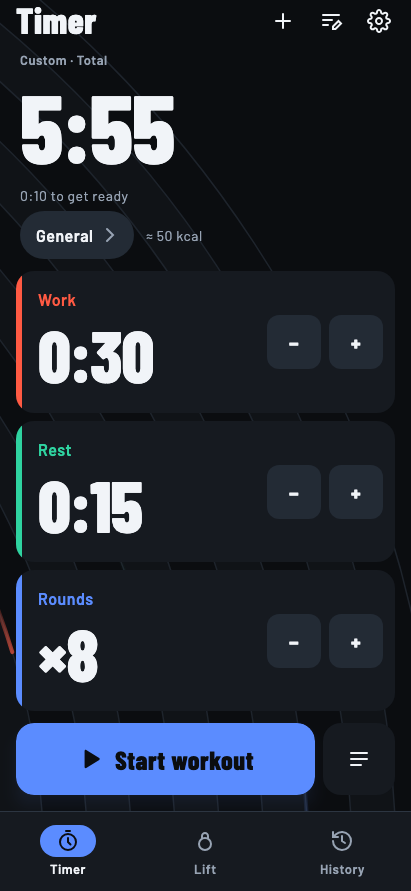
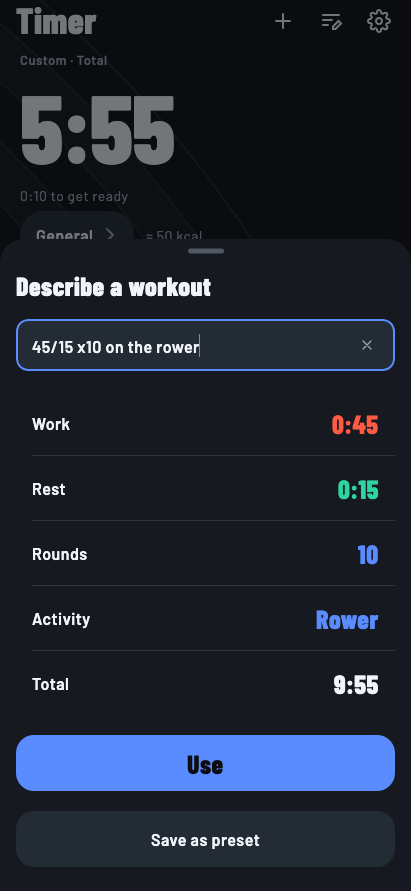
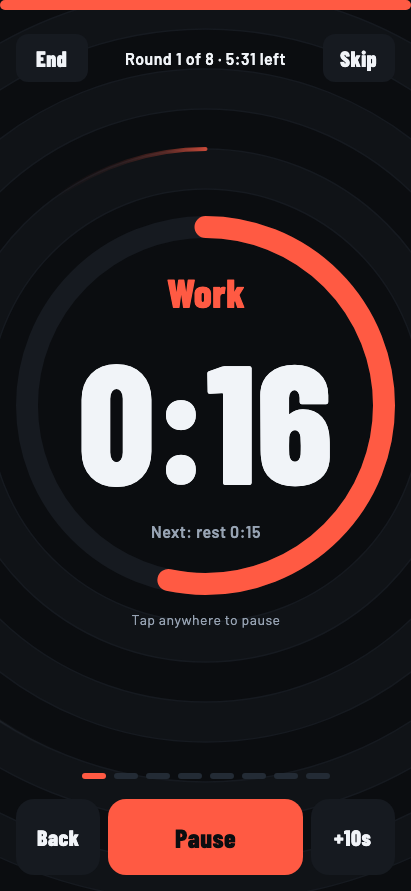
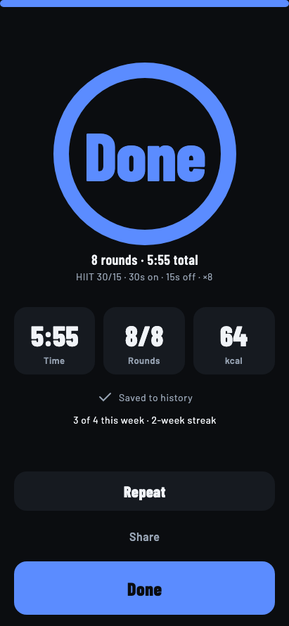
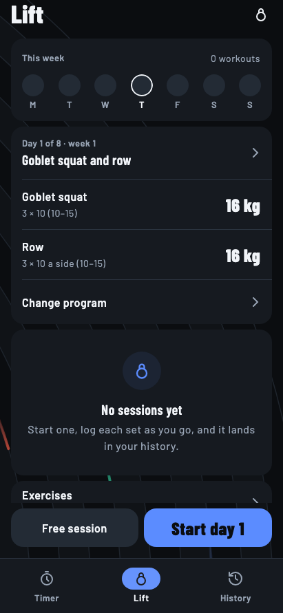
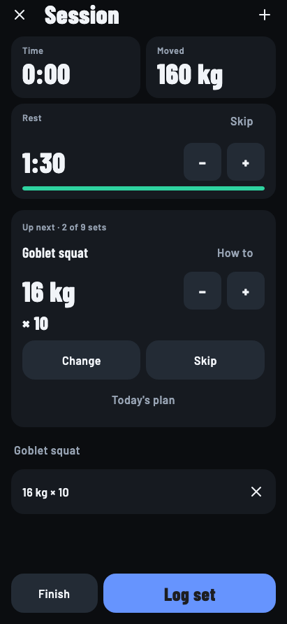
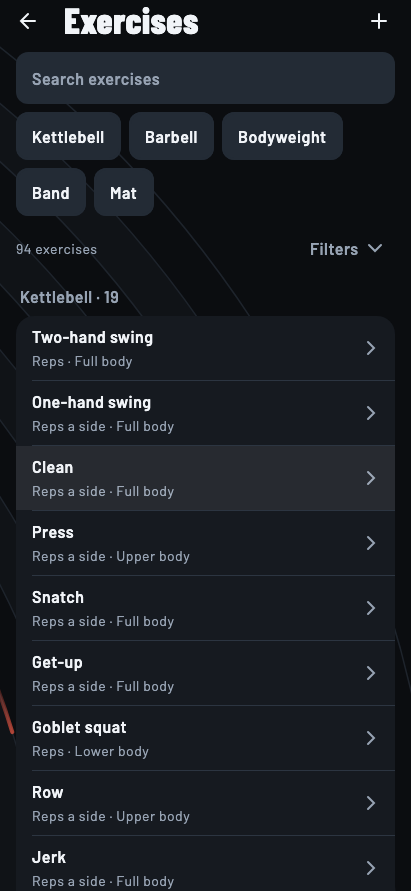
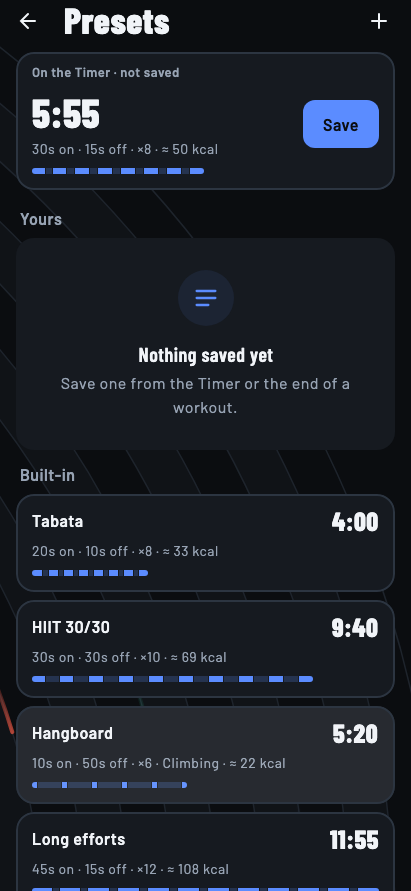
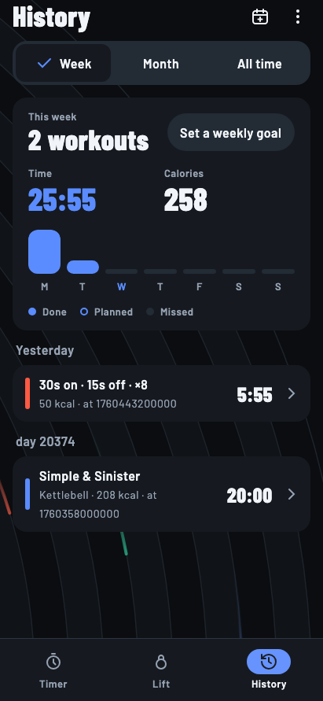
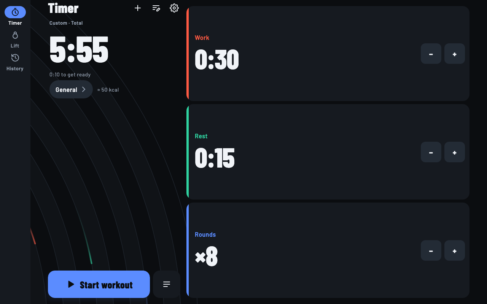

<div align="center">

# ⏱️ Interval

**An offline-first, privacy-focused interval workout timer and strength training tracker.**  
Built with **Compose Multiplatform** for **Android**, **iOS**, and **Desktop (JVM)**, powered by the **Kotlin Toolchain** (Amper-based).

[](https://kotlinlang.org/docs/multiplatform.html)
[](https://www.jetbrains.com/lp/compose-multiplatform/)
[-0095D5)](https://kotlin-toolchain.org/latest/)
[](#prerequisites)
[](#-privacy-first--offline)
[](LICENSE)

<br/>

<p align="center">
  <a href="#-features">Features</a> •
  <a href="#-app-showcase">App Showcase</a> •
  <a href="#-architecture--tech-stack">Architecture</a> •
  <a href="#-getting-started">Getting Started</a> •
  <a href="#-testing">Testing</a> •
  <a href="#-documentation">Docs</a>
</p>

</div>

---

## 📱 App Showcase

### ⏱️ High-Intensity Interval Timer

| 1. Precision Timer Setup | 2. Natural Language Input | 3. Active Workout Ring | 4. Workout Summary |
|:---:|:---:|:---:|:---:|
|  |  |  |  |
| *Work, rest, rounds steppers with calorie burn estimate* | *Type "45/15 x10 on rower" for instant parsing* | *Vibrant circular ring, phase countdown & controls* | *Detailed statistics, calories burned & weekly streaks* |

### 🏋️ Strength & Kettlebell Tracking (Lift)

| 1. Lift Dashboard | 2. Active Session & Rest Clock | 3. Exercise Library | 4. Interval Presets |
|:---:|:---:|:---:|:---:|
|  |  |  |  |
| *Weekly goal ring, current program & quick start* | *Sets, weight × reps logging & automatic rest clock* | *100+ movements with muscle filters & form cues* | *Tabata, HIIT, EMOM, Hangboard & custom cards* |

### 📅 Unified Training Log & Adaptive Layouts

| Unified Training Log & Calendar | Adaptive Tablet & Desktop Experience |
|:---:|:---:|
|  |  |
| *Unified history uniting cardio intervals and strength sessions with weekly volume charts and goal tracking* | *Adaptive two-pane layout built with Navigation 3 and Compose Adaptive Scaffold that scales seamlessly from phones to tablets and desktop* |

---

## ✨ Features

### ⏱️ Precision Interval Timer
- **Customizable Intervals**: Precise configuration for work, rest, and round durations with rapid steppers and quick-pick sheets.
- **Natural Language Parsing**: Describe workouts in plain English (e.g., `"40/20 x8 on the rower"`, `"tabata"`, `"hangboard 7/3 x6"`), automatically parsed into timer configurations.
- **Audio & Haptic Cues**: High-contrast audible beeps, spoken phase cues via system text-to-speech, halfway warnings, and vibration pulses.
- **Visual Timelines**: Scaled phase rings and progress timelines that dynamically adjust to any aspect ratio.
- **Background Persistence**: Accurately tracks when backgrounded or locked — Android uses a foreground service with lock-screen controls; iOS schedules local notifications ahead per phase transition.

### 🏋️ Strength & Kettlebell Training (Lift)
- **Built-in & Custom Programs**: 29 built-in programs across 6 training families (Simple & Sinister, Rite of Passage, Quick & the Dead, etc.), with an interactive block and rep-range editor.
- **100+ Exercise Library**: Extensive movement catalog categorized by muscle groups (kettlebell, barbell, bodyweight, bands) complete with form cues and custom movement creation.
- **Session Tracking**: Sets, weights, reps, EMOM timers, hold clocks, and automatic rest intervals.
- **Screen-Off Rest Alerts**: Android counts rest on the lock screen and beeps when finished; iOS fires local notifications.
- **Personal Records (PRs)**: Automatic PR detection and volume load progression tracking.

### 📅 Unified History, Planning & Streaks
- **Integrated Training Log**: Daily calendar view, 12-week volume charts, weekly goals, and streak tracking that unifies cardio and strength workouts.
- **Routines & Reminders**: Schedule recurring workouts by weekday with reboot-resilient notification reminders.
- **Calorie Estimation**: Dynamic calorie expenditure calculations based on exercise type, duration, and body weight.

### 🔒 Privacy-First & Offline
- **Zero Tracking**: No accounts, no sign-ups, no ads, and zero analytics or telemetry.
- **Local SQLite Storage**: Encapsulated Room multiplatform database running locally on device storage.
- **Full Data Ownership**: Export entire workout histories to standard JSON (schema 1) with seamless restore and Android system backup support.
- **Accessibility**: Semantic headings, full TalkBack and VoiceOver navigation, and reduced-motion mode.

---

## 🏗️ Architecture & Tech Stack

Interval is designed around modern multiplatform architecture principles, cleanly separated into 25 modular packages:

```
interval/
├── androidApp/          # Android application host & manifest
├── desktopApp/          # Desktop JVM application host (Compose Hot Reload ready)
├── iosApp/              # iOS Swift host & Xcode wrapper
├── shared/              # Application container, Navigation 3 backstack, AppKoin
│
├── core/                # Design tokens, IntervalTheme, NavigationArea, utilities
├── core-platform/       # Clocks, timestamp formatter, storage plumbing (zero Compose dependencies)
├── core-time/           # Pure calendar maths (zero dependencies)
├── core-testing/        # MainDispatcherTest, UI test harness, fake platform services
│
├── interval-domain/     # Timer engine, workout state machine, calorie math, parsers
├── interval-data/       # Room database (AppDatabase), DataStore settings, repositories
├── interval-platform/   # Audio/speech cues, Android Foreground Service, iOS notifications
├── interval-ui/         # Shared workout widgets, Timeline, PhaseColors, Splash
├── interval-home/       # Timer tab and natural language describe sheet
├── interval-workout/    # Live workout screen, circular countdown readout, summaries
├── interval-presets/    # Preset editor, built-ins, custom preset cards
├── interval-history/    # History calendar, training log, routine planner & reminders
├── interval-settings/   # Settings sheet, cues toggle, theme selector, data export
├── interval-testing/    # FakeStorage, RecordingCuePlayer, fake DAOs
│
├── bells-domain/        # Lift domain: exercises, programs, EMOM/hold clocks, PRs
├── bells-data/          # Lift Room database (BellsDatabase), repository
├── bells-platform/      # Lift's beeper, rest alert service, platform Koin module
├── bells-ui/            # Lift widgets, exercise formatters, cues mapping
├── bells-library/       # Exercise library, search, filters, exercise editor
├── bells-session/       # Active session logger, rest clocks, program progress
├── bells-today/         # Lift tab, gear inventory (bells, bar, bands, records)
├── bells/               # Lift navigation entry point & route definitions
├── bells-testing/       # FakeBellsStorage, RecordingBeeper, fake DAOs
│
├── detekt-plugin/       # Custom toolchain plugin for Detekt analysis
├── lint-plugin/         # Custom toolchain plugin for ktlint checks & formatting
├── journeys/            # End-to-end on-device user flows (android CLI)
└── tools/               # Icon generators & version parity validation scripts
```

### Key Libraries & Tools
- **UI Framework**: [Compose Multiplatform](https://github.com/JetBrains/compose-multiplatform) (Desktop, Android, iOS)
- **Navigation**: [Jetpack Navigation 3](https://developer.android.com/guide/navigation) with adaptive multi-pane layouts
- **Dependency Injection**: [Koin](https://insert-koin.io/) & `koin-compose`
- **Database & Persistence**: [Room KMP](https://developer.android.com/kotlin/multiplatform/room) with SQLite driver + AndroidX DataStore
- **Build Toolchain**: [Kotlin Toolchain (Amper)](https://kotlin-toolchain.org/latest/) — **No Gradle daemon, zero `build.gradle.kts` files**
- **Architecture Guide**: For in-depth rules and layer boundaries, see [docs/architecture.md](./docs/architecture.md).

---

## 🚀 Getting Started

### Prerequisites

The repository includes self-bootstrapping wrappers (`./kotlin` for macOS/Linux, `kotlin.bat` for Windows) for the **Kotlin Toolchain**. The wrapper automatically provisions the pinned toolchain version, Java runtime, and core dependencies on its first run.

- **Desktop (JVM) & Android**: JDK and Android SDK components are auto-provisioned by the toolchain.
- **iOS**: Requires macOS with Xcode installed to compile Kotlin/Native frameworks.
- **Tools**: Python 3 is required for release and version validation scripts (`tools/check_versions.py`).

### Common Commands

```sh
# Build everything (including iOS link on macOS)
./kotlin build

# Fast compile loop (common + JVM only)
./kotlin build -p jvm

# Run all checks (unit tests + ktlint + Detekt)
./kotlin check

# Run code formatters
./kotlin do format

# Run Detekt static analysis
./kotlin check detekt
```

---

## 🏃 Running the Apps

### Desktop (JVM)
```sh
# Standard run
./kotlin run -m desktopApp

# Fast UI development with Compose Hot Reload (updates code on save without restarting)
./kotlin run -m desktopApp --compose-hot-reload
```

### Android
```sh
# Run on a connected Android device or running emulator
./kotlin run -m androidApp

# Or launch directly with the android CLI:
android emulator start amper-37
android run --apks=build/tasks/_androidApp_buildAndroidDebug/gradle-project-debug.apk
```

### iOS
```sh
# Build and run the iOS app on an iOS simulator
./kotlin run -m iosApp
```

---

## 🧪 Testing

Interval follows a strict testing pyramid designed for fast local iteration and multiplatform correctness:

```sh
# Fast test loop: domain logic and Compose UI tests on desktop JVM (~10s)
./kotlin test -p jvm

# Run tests for a specific module
./kotlin test -m interval-history -p jvm
./kotlin test -m bells-domain -p jvm
./kotlin test -m bells -p jvm

# Run common tests against Android local JVM environment
./kotlin test -p android

# Run common tests in iOS Simulator (macOS only)
./kotlin test -p iosSimulatorArm64
```

- **Logic & ViewModels**: Tested in `<module>/test/` across JVM, Android, and iOS simulator.
- **Compose UI Tests**: Located in `<module>/test@jvm/` to render off-screen with Skiko via the `core-testing` harness.
- **Acceptance Specs**: End-to-end user flows validated on the JVM (`shared/test@jvm/acceptance/`).
- **On-Device Journeys**: XML-driven end-to-end flows in `journeys/*.xml` executed via the `android` CLI.

For testing architecture, harnesses, and test fakes, see [docs/testing.md](./docs/testing.md).

---

## 📚 Documentation

- [Architecture Guide](./docs/architecture.md): System architecture, Navigation 3 backstack, Room multiplatform, and background execution.
- [Testing Strategy](./docs/testing.md): Compose UI desktop harness, fakes, and on-device journeys.
- [Release Guide](./docs/release.md): Release preparation, R8 optimization, keystore setup, and deployment checklist.
- [Developer Guide (CLAUDE.md)](./CLAUDE.md): Code conventions, architecture invariants, and toolchain command reference.
- [Changelog](./CHANGELOG.md): History of notable changes and milestone releases.

---

## 🔀 Version Control

This repository uses [Jujutsu (jj)](https://github.com/martinvonz/jj) colocated with Git (`.jj/` alongside `.git/`).
```sh
jj st                  # Check working copy status
jj describe            # Set commit message
jj new                 # Create a new working-copy commit
jj git push            # Push commits to remote Git branches
```
*(A detached Git `HEAD` is expected and normal in colocated repositories).*

---

<div align="center">
  <sub>Built with ❤️ using Compose Multiplatform & Kotlin Toolchain.</sub>
</div>
