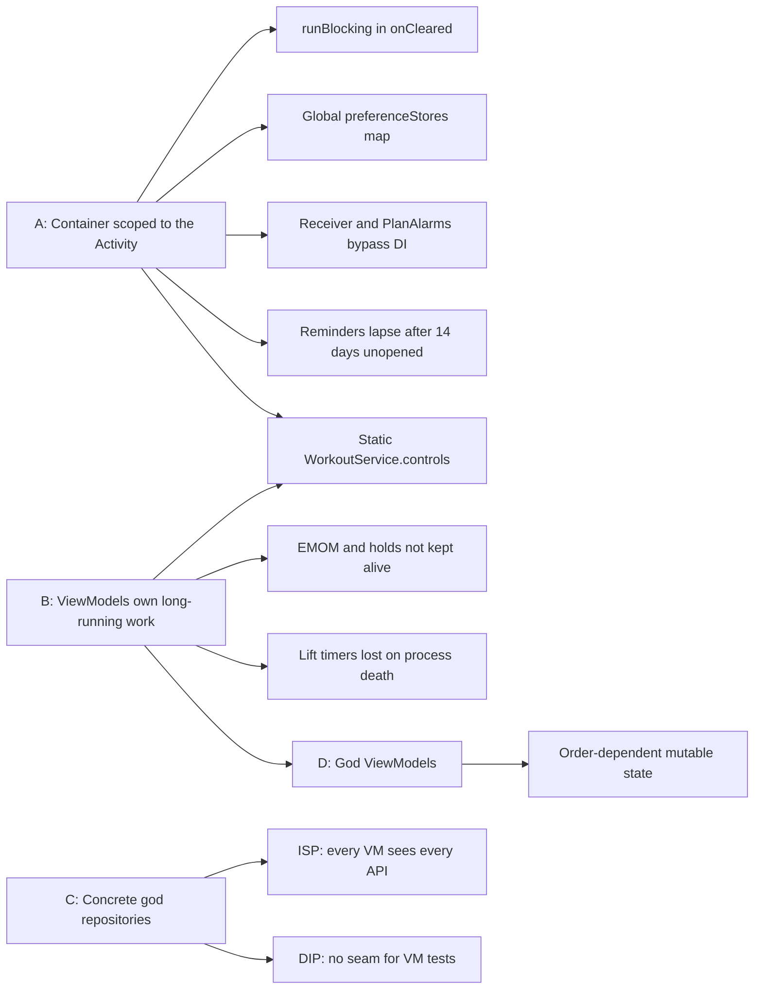

# Architecture review — 2026-10-31

A review of the whole codebase (29 modules, about 57k lines of Kotlin) against SOLID, Android's lifecycle and
platform guidance, and data-layer correctness. The work it calls for is planned in
[sprint-architecture.md](sprint-architecture.md); the architecture as it stands is [architecture.md](architecture.md).

Line numbers are as of commit `09a932a2` and will drift; the symbol named beside each is the stable reference.
Each finding has an id (**A1**, **S3**, …) that the sprint's tickets cite.

---

## Summary

The architecture is well above average. The module graph is enforced in CI (`tools/check_module_rules.py`),
both domains are pure Kotlin, platform services sit behind interfaces with recording fakes, writes are ordered
and drained (`SerialWriter`), the interval workout survives process death, and journeys have acceptance specs.

The weaknesses trace to **four root causes**. Most findings below are symptoms of one of them:

| Root cause | What it causes |
|---|---|
| **A. The DI container lives as long as the Activity, not the process.** It is built in composition and held by a `ViewModel` (`KoinHolder`). | `runBlocking` on main as it closes; a process-global DataStore map outside DI; a static Service↔ViewModel bridge; a receiver with its own storage path; reminders recomputed only while the UI is open. |
| **B. Long-running work is owned by ViewModels.** The workout's ticker and Lift's rest, EMOM and hold timers run in `viewModelScope`. | The foreground service can't work without the ViewModel; EMOMs and holds aren't kept alive with the screen off; Lift's timers are lost on process death. |
| **C. Two concrete repositories that do everything, with no interfaces.** | Every ViewModel sees every API (ISP); no seam for ViewModel tests (DIP); ViewModels wired by positional `scope.get()`. |
| **D. Two ViewModels that do everything.** `SessionViewModel` (856 lines), `WorkoutViewModel` (484). | Mixed responsibilities, order-dependent mutable `var`s, `@Suppress(TooManyFunctions, LongParameterList)`. |

### Scorecard

| Area | Grade | In one line |
|---|---|---|
| Modularity and layering | A | Enforced in CI; pure domains; feature edges allow-listed |
| Domain design | A− | Pure and tested; `IntervalConfig` has no invariants; `Equipment` branches everywhere |
| S: Single Responsibility | C+ | Two god repositories, two god ViewModels |
| O: Open/Closed | B− | Navigation and DI extend cleanly; about 70 `Equipment` `when` branches don't |
| L: Liskov Substitution | A | Fakes keep their contracts; `NoHealthStore` is a true null object |
| I: Interface Segregation | C | `LiftActivity`/`IntervalActivity` are the model; nothing else follows them |
| D: Dependency Inversion | B | Platform services inverted; repositories, IDs and some clocks not |
| Android lifecycle and services | B− | Services mostly right; the container's scope and the static bridge are not |
| Data correctness | B− | Ordered writes; one race, multi-writes without transactions, no foreign keys |
| Testing | A− | ATDD, migrations, UI; no repository interfaces limits isolation |

---

## A. Lifecycle and DI scope

### A1 · High · The container is Activity-scoped

**Resolved** in change `uzpqsrpn` ("DI: one container per process"): `initAppKoin` starts it once per process
from Android's `IntervalApplication`, desktop's `main` and iOS's first frame. `KoinHolder`, its `runBlocking` and
`preferenceStores` are gone (A1a, A1b), the databases open once (A1c), and the container is never closed on
Android, so no write arrives after it (A1e). Services and receivers can now reach it (A1d); using that is
ticket 3's and 4's.
`rememberAppKoin()` ([AppKoin.kt:84-92](../apps/app/src/di/AppKoin.kt)) builds the container inside
`viewModel { KoinHolder(...) }`. It survives a rotation and dies with the Activity. The platform modules are
`@Composable` because they need `LocalContext`
([PlatformServices.android.kt](../interval/interval-platform/src@android/platform/PlatformServices.android.kt)).
What follows from that:

- **A1a** `KoinHolder.onCleared` blocks the main thread with `runBlocking` for up to 2 s to drain both
  repositories ([AppKoin.kt:61-74](../apps/app/src/di/AppKoin.kt)).
- **A1b** `preferenceStores` ([DataKoin.kt:52-65](../interval/interval-data/src/di/DataKoin.kt)) is a process
  singleton outside DI. It exists only because a new container can be built before the old DataStore lets go of
  its file.
- **A1c** The database is opened again each time the user backs out and relaunches in the same process.
- **A1d** Components the system creates (services, receivers) can't reach the graph. That leads to the static
  bridge (**B1**), a separate `object PlanAlarms` DataStore for `PlanReminderReceiver`, and
  `PlanReminderScheduler` running only while the Activity lives (**A2**).
- **A1e** Teardown order: if `KoinHolder` clears before the nav entries' ViewModel stores, the writes
  `WorkoutViewModel.onCleared` makes (`saveWorkoutProgress(null)`, the reflection) arrive after
  `SerialWriter.close()`. They are dropped with only a warning
  ([Storage.kt:37-38](../core/core-platform/src/storage/Storage.kt)).

**Recommendation.** Build the container once per process:
- Android gets an `Application` subclass that builds it from `applicationContext`.
- iOS and desktop build it at their entry points, all through one shared `initAppKoin(...)`.
- Keep it isolated (no global `startKoin`) by handing the `KoinApplication` to `App`.
- Platform modules become plain functions of a `Context`.

### A2 · Medium · Plan reminders can lapse

**Resolved** on Android in change `puqvnxtu` ("Reminders: kept going by each alarm, worded as they show"): an alarm carries its day alone. `PlanReminderReceiver`
reaches the container (`KoinComponent`) and asks `PlanReminderSource`, which `PlanReminderScheduler` is, for the day's
reminder as the plan now stands, words it as it shows, then reschedules from now, so the 14 days move on whether or
not the app is opened. A reboot or a change of clock or time zone reschedules rather than replaying a record, which
now holds only the days, to cancel them. iOS is as it was: its notifications carry their words from when they are
scheduled, and no app code runs as one shows, so its window moves only while the app runs. A1d is resolved for
receivers; the workout's service is ticket 4's.
- Alarms reach `PLAN_REMINDER_DAYS = 14` days ahead and are recomputed only by `PlanReminderScheduler`, which
  lives in the Activity-scoped container.
- `PlanReminderReceiver` re-arms recorded alarms but never extends the window, so a user who doesn't open the app
  for two weeks stops being reminded.
- The text is baked into the alarm's intent when the alarm is set
  ([PlanReminders.android.kt](../interval/interval-platform/src@android/platform/PlanReminders.android.kt)), so a
  language change shows the old words.

**Recommendation.** With **A1** fixed, the receiver runs the scheduler on each alarm (extending the window) and
words the notification at delivery.

---

## B. Long-running work

### B1 · High · Service and ViewModel talk through static mutable state

**Resolved** in change `wozvuwrm` ("Workout: the running workout owned by the process, not its screen"):
`WorkoutSession`, a Koin single, runs the workout, and `WorkoutService` injects it as the `ActiveWorkout` port
(`KoinComponent`), shows its `status` and acts on it. The companion's `status` and `controls` are gone, and so is the
ViewModel's part in it: the workout runs on when the screen is destroyed, and ends when its page leaves the back stack.

- `WorkoutService`'s companion holds `internal val status = MutableStateFlow<WorkoutStatus?>` and
  `internal var controls: WorkoutControls?`. `controls` is not `@Volatile` and holds an object owned by the
  ViewModel ([WorkoutService.kt](../interval/interval-platform/src@android/platform/WorkoutService.kt),
  [BackgroundWorkout.android.kt](../interval/interval-platform/src@android/platform/BackgroundWorkout.android.kt)).
- The notification's Pause and End call into ViewModel code from `onStartCommand`.
- The service mirrors an object in the UI layer: it can't work without that ViewModel in the same process, and
  a missed `stop()` leaks the ViewModel.

**Recommendation.** A process-scoped `WorkoutSession` owns the running workout. The service injects it and
observes it; the ViewModel only views it.

### B2 · Medium · EMOMs and holds aren't kept alive off screen

**Resolved** in change `mnmxnyxt` ("Lift: the rest, an EMOM and a hold kept alive off screen, owned by the process"): `SessionTimers` (`lift-session`, a Koin single) owns
the rest, the EMOM and the hold, and `SessionKeepAlive` keeps whichever runs (`TimerRun`): Android's `TimerService`,
iOS's notification at its end. Starting an EMOM or a hold over a rest hands the keep-alive on without a stop.

- `SessionViewModel` builds `RestTimer`, `EmomRunner` and `HoldTimer` itself (about L249-257). All three tick on
  `viewModelScope`/Main (L260-265, L372-374).
- Only a rest starts `RestService` and its wake lock. Starting an EMOM (up to 60 min) calls `rest.skip()` →
  `alerts.stop()` (L585, L610), and a hold starts nothing.
- `KeepScreenOn` (EmomScreen.kt:122) helps only while the screen is composed. With the power button pressed the
  CPU may sleep and the EMOM goes silent.

**Recommendation.** A process-scoped `SessionTimers` owns the three runs, with one keep-alive service for
whichever is running.

### B3 · Medium · Lift's timers and draft are lost on process death
The draft, the edit state and all three runs live only in memory; there is no `SavedStateHandle`, unlike the
Lift editors. The sets survive in Room, but a process killed mid-EMOM loses the EMOM, and `RestService` counts
on without its beep (the beep comes from the ViewModel).

**Recommendation.** Persist each run (start, as epoch millis, plus its config) and restore it, as
`WorkoutProgress` does for the workout.

**Resolved** in change `nznvzvzq` ("Lift: a rest, an EMOM or a hold survives the process"): `SessionTimers` saves the
run going on the session in progress (`SavedTimer`, a `timer` JSON column, Lift's database version 14) at each
change of course, and `SessionViewModel` restores it once as the session opens, timed again by the wall clock;
one over meanwhile is dropped without a beep or a set. The Log sheet's draft is in `SavedStateHandle`. The edit
state is not kept: the set being changed is in Room, and the sheet comes back to the new set's draft.

### B4 · Medium · RestService's wake lock timeout is never renewed

**Resolved** in change `kroqzppq` ("Lift: a plan change never lost, whole writes, and the rest's wake lock renewed"): the lock is no longer reference-counted, and each rest acquires
it afresh until its end, the linger and a few seconds' margin, so rests back to back never outlast it.
`countDown` acquires for 15 minutes only when the lock isn't already held
([RestAlerts.android.kt:125](../lift/lift-platform/src@android/platform/RestAlerts.android.kt)). A new rest
replaces a running one without restarting the service, so back-to-back rests keep the service but lose the lock
15 minutes after the first.

**Recommendation.** Release and re-acquire for `endAt - now + margin` on each `countDown`.

### B5 · Low · Lift's timers count wall-clock time

**Resolved** in change `mnmxnyxt`: the timers count `realElapsedTime` through a `RunClock`; the wall
clock only tells the platform when a run ends.

Rest, EMOM and hold measure with `clock.nowMillis()`, so an NTP or manual clock change bends them. The interval
side uses the monotonic `realElapsedTime`, and `dataModule` already provides it.

---

## C. Repositories and dependency direction

### C1 · High · `LiftRepository` does nine jobs (SRP)
[LiftRepository.kt](../lift/lift-data/src/data/LiftRepository.kt) is 667 lines, takes 7 DAOs and carries
`@Suppress TooManyFunctions`. It:
- caches nine tables
- runs the session lifecycle
- writes sets
- handles programs and following
- handles exercises
- stores gear
- runs import
- maps entities
- holds business policy: `saveChanges` copies a built-in and re-follows it; `removeBand` decides archive vs
  delete.

**Recommendation.** Split it into `SessionRepository`, `ProgramRepository`, `ExerciseRepository` and
`GearRepository` over a shared catalog flow. Move the policy into use cases and the mappers into their own file.

### C2 · High · `IntervalRepository` does six jobs (SRP)
[IntervalRepository.kt](../interval/interval-data/src/data/IntervalRepository.kt) covers settings (three
kinds), workout progress, presets (with naming rules), history, plans and import: 9 StateFlows and about 20
mutators.

**Recommendation.** Role interfaces first (**C3**); split the class later if it keeps growing.

### C3 · High · ViewModels take the whole concrete repository (ISP, DIP)
- `GearViewModel` uses only bells, bar and bands. `TimerViewModel` uses only config and presets but can call
  `clearHistory()` and `importAll()`.
- With no interface, every ViewModel test builds the real repository over fake DAOs.
- `LiftActivity` ([LiftActivity.kt](../lift/lift-data/src/data/LiftActivity.kt)) already shows the pattern: a
  narrow port per consumer.

**Recommendation.**
- Interval: `SettingsStore`, `PresetStore`, `HistoryStore`, `PlanStore`, `WorkoutProgressStore`.
- Lift: `SessionStore`, `ProgramStore`, `ExerciseStore`, `GearStore`.
- Have the existing classes implement them, and inject the interfaces.

### C4 · Medium · ViewModels are wired by a service locator in composables (DIP)

**Resolved** in change `kzoutvkm` ("DI: ViewModels declared in each feature's Koin module"): each feature
declares its ViewModels in its own Koin module, Routes resolve them with `koinViewModel`, and
`VerifyAppModulesTest` checks the whole graph.
- Routes build ViewModels with positional `scope.get()` calls, eight in `WorkoutScreen.kt:103` and
  `SessionScreen.kt:115`.
- No ViewModel is declared in a Koin module, so the graph is spread across Route composables, and reordering a
  constructor's same-typed parameters breaks it silently.

**Recommendation.** `viewModelOf(::XViewModel)` in each feature's Koin module; `koinViewModel { parametersOf(id) }`
in the Route.

### C5 · Low · IDs and some clocks are hard-coded
- `Uuid.random()` is called inside both repositories.
- `System.currentTimeMillis()` is used in `RestAlerts.android.kt` and `PlanReminders.android.kt`, and
  `epochMillisNow()` on iOS, beside an injected `WallClock`.

**Recommendation.** Inject an `IdGenerator`, and use `WallClock` everywhere.

---

## D. ViewModels

### D1 · High · `SessionViewModel` does eight jobs
[SessionViewModel.kt](../lift/lift-session/src/session/SessionViewModel.kt) covers:
- draft editing and suggestions
- plan editing (change, skip, swap)
- three timers, the tick loop and cues
- edit mode for logged sets
- the finish workflow (records, plan changes, week standing, Health)
- summary reflection
- library filtering
- an "await the newly added exercise" workaround.

**Recommendation.** A `SetDraftEditor` state holder, `SessionTimers` (**B2**), a `FinishSession` use case and a
`TodayPlanEditor`.

### D2 · High · `WorkoutViewModel` is the session engine as well as the screen's state

**Resolved** in change `wozvuwrm` ("Workout: the running workout owned by the process, not its screen"): the run is a
pure `WorkoutRun`, `WorkoutSession` does what each change asks (the ticker through `WorkoutTicker`, cues, checkpoint,
the platform's hold), `WorkoutRecorder` keeps History and Health, and `WorkoutViewModel` takes the session and the
repository and maps one to `WorkoutUiState`, with no `var`s and no `@Suppress`. The reflection's second Health write
runs as the session leaves, not in `onCleared` (A1e's last writes there).

[WorkoutViewModel.kt](../interval/interval-workout/src/workout/WorkoutViewModel.kt) has 9 dependencies and about
15 mutable `var`s. The order `turn()` → `publish()` → `checkpoint()` matters. It mixes the ticker, cues, Health's
course spans, checkpointing, the service lifecycle and the week standing.

**Recommendation.** `WorkoutSession` (**B1**) plus a `WorkoutRecorder` (history and Health); the ViewModel maps
state to `WorkoutUiState`.

### D3 · Medium · Snapshot reads inside reactive pipelines
- `upNext()` reads `repository.bar.value`, `bands.value` and `draft.value` inside a `combine` that already takes
  them (SessionViewModel L823-827).
- `ProgramEditorViewModel` reads `repository.sessions.value` inside a combine (L64).
- `setsBefore` and `setsBeforeOldestFirst` are frozen at construction (L238-241), so deleting a past session or
  importing mid-session leaves records and suggestions wrong.

### D4 · Low · I/O in lifecycle callbacks
`SessionViewModel` starts a session in `init` and writes to Health in `onCleared`. A process killed before
`onCleared` loses the note.

### D5 · Low · A side effect inside `update {}`

**Resolved** in change `vowprrrt` ("Guards: a config in range wherever it comes from, an import review that fails ends"): `change` takes the draft from `updateAndGet` and persists it after.
`ProgramEditorViewModel` encodes JSON and writes `SavedStateHandle` inside `_state.update {}` (L75-80). The
lambda can run more than once.

---

## E. Data correctness

### E1 · High · Lost update on a session's plan

**Resolved** in change `kroqzppq` ("Lift: a plan change never lost, whole writes, and the rest's wake lock renewed"): `changeSessionPlan` takes a change of the session as stored and
works it out inside the writer, behind every write before it; nothing is written to `active` optimistically, so a
stale read can only lag the screen for a moment. `SessionViewModel`'s plan edits and `stepNextLoad` each pass one.
No pending overlay: nothing depends on what is drawn.
[`LiftRepository.setSessionPlan`](../lift/lift-data/src/data/LiftRepository.kt) (L353-359) sets
`_active.value = _active.value?.copy(plan = plan)` optimistically on Main. The collector on IO (L154-159)
overwrites `_active` with every database emission. An emission computed before the plan's write lands restores
the old plan, and the next edit, built on `today()`, silently drops the change.

**Recommendation.** Do the read-modify-write inside the writer, or keep a pending overlay that clears when the
database confirms. Use `update {}` everywhere.

### E2 · Medium · Multi-statement writes without a transaction; no foreign key

**Resolved, but for the foreign key,** in change `kroqzppq` ("Lift: a plan change never lost, whole writes, and the rest's wake lock renewed"): `@Transaction` DAO methods do each job
in one step (`SessionDao.finishActive` and `discardActive`, `CustomProgramDao.deleteProgram`,
`BandDao.removeOrArchive`, which asks `EXISTS` rather than loading every set). The foreign key is still open.
- `discardSession`, `deleteProgram`, `finishSession` (count, then finish) and `removeBand` each make several DAO
  calls outside a transaction; only import uses `@Transaction`.
- `lift_set` has no foreign key to `session` (LiftDatabase.kt:321), so a crash halfway leaves orphan sets.
- `removeBand` loads every set to check one band.

**Recommendation.** `@Transaction` DAO methods; an `EXISTS` query; a foreign key with `ON DELETE CASCADE` through a
migration.

### E3 · Medium · `IntervalConfig` has no invariants

**Resolved** in change `vowprrrt` ("Guards: a config in range wherever it comes from, an import review that fails ends"): the constructor (and so every `copy`) requires each value in its range,
and `IntervalConfig.sanitized(...)` takes raw values to the nearest in range. Every mapper from storage uses it: the
Room rows (`intervalConfig`), the DataStore (`toConfig`), the saved workout (`StoredProgress.toDomain`) and the preset
editor's saved state. `ImportPlanner` still refuses a file out of range, field by field, before the constructor.
The ranges are enforced only in `withValue`
([IntervalConfig.kt](../interval/interval-domain/src/timer/IntervalConfig.kt)). The DataStore, Room, progress
and import mappers build configs unchecked, so `rounds = 0` gives a negative `totalSeconds`.

**Recommendation.** `init { require(...) }`, or a `sanitized()` factory used by every mapper.

### E4 · Medium · Write failures are silent
`SerialWriter.persist` logs and swallows ([Storage.kt:72-80](../core/core-platform/src/storage/Storage.kt)),
and the repository APIs return `Unit`. A failed `logSet` or `recordWorkout` is invisible.

**Recommendation.** `writeErrors: SharedFlow`, shown as a notice; `await` for the writes the user must see land.

**Resolved** in change `tkvsnrvx` ("Storage: a save that fails says so"): `SerialWriter.errors` publishes each
failed `persist`, both repositories expose it as `writeErrors`, and `AppContent` shows "Couldn't save. Try again."
as a notice over any screen. `await` throws to its caller and publishes nothing (the import says its own). The
writes stay `persist`: nothing acts on whether one landed yet, and the notice already tells the user.

### E5 · Medium · Import across the two stores
- The interval import is one transaction; Lift's and the settings are separate steps (a known, documented
  trade-off).
- `SettingsViewModel.reviewImport` (L191-199) has no error handling, so an exception leaves the step at `Reading`
  and blocks further imports.

**Resolved for `reviewImport`** in change `vowprrrt` ("Guards: a config in range wherever it comes from, an import review that fails ends"): a review that throws ends at `Failed`, as an import
does, and another file can be chosen. The import across the two stores stays the documented trade-off.

### E6 · Low · Two StateFlows published separately

**Resolved** in change `vowprrrt` ("Guards: a config in range wherever it comes from, an import review that fails ends"): `presets` is the one list kept, and `customPresets` is derived from it
(`stateIn` on the storage scope). Derived the other way round, `presets` would trail `ready` by a dispatch, and
`WorkoutViewModel` and every tab read it; this way only `customPresets` can trail, for a moment, and only Export
reads it.
`_customPresets` and `_presets` are set in two writes on IO (IntervalRepository L115-118).

**Recommendation.** Derive one flow from the other.

---

## F. Presentation and performance

### F1 · Medium · First states built on the main thread
- `HistoryViewModel` and `PlanViewModel` call `buildState(...)` for `initialValue`, on the caller, with
  `SharingStarted.Eagerly` ([HistoryViewModel.kt:124-147](../interval/interval-history/src/history/HistoryViewModel.kt)).
  The build walks the whole history and calendar.
- History's combine includes `repository.config`, so each Timer stepper tap rebuilds History.

**Recommendation.** A cheap first state; drop `config` (or narrow it with `map {}.distinctUntilChanged()`);
`WhileSubscribed(5_000)`.

**Resolved** in change `qyzuvmuy` ("History and Plan: a cheap first state, and the Timer's steps rebuild neither"):
both start from `Loading` and build every state on the computation dispatcher; `config` feeds only `choices`,
worked out on their own and joined last, so a Timer step rebuilds nothing else. They keep `Eagerly`: the first
state is what cost, and `WhileSubscribed` would show Loading again on each return to the tab.

### F2 · Medium · Whole history reprocessed on every change
- `observeSets()` streams every set, including those of deleted sessions, and every insert re-maps the whole
  history.
- `SessionViewModel`'s `untimed` combine runs on Main with no `flowOn`, recomputing records and recent exercises
  on each stepper tap. `TodayViewModel` already injects a computation dispatcher; follow it.

### F3 · Low · One big UiState copied every tick

**Resolved** in change `mnmxnyxt`: `SessionViewModel.clocks` (`SessionClocks`) carries the clocks, read
only by the tiles, the EMOM's screen and the hold's countdown; `state` no longer moves with the tick.

A 250 ms tick feeds the whole `SessionUiState`, so every child that takes `state` recomposes each second.

**Recommendation.** A separate `clocks: StateFlow`, collected only by the timer tiles.

### F4 · Low · Screen-only state lost on process death
History's range, month and open day are in a plain `MutableStateFlow`.

**Recommendation.** `SavedStateHandle`, as the Lift editors do.

---

## G. Open/Closed and modules

### G1 · Medium · `Equipment` branching (OCP)
- There are about 70 `Equipment.*` branches across 11 files (`SetWords`, `SessionViewModel` ×17, `LoadPicker`,
  `LogSheet`, `Progression`, `Suggestions`, `LoadSteps`, `HealthWorkouts`, the repository).
- `SetDraft` has a field per equipment; `SetLog.bellKg` doubles as a generic load.
- Adding dumbbells would touch about 11 files.

**Recommendation.** A sealed `Load` type (`Bell`, `Bar`, `Band`, `Bodyweight`), with behaviour on the type.

### G2 · Low · Exported dependencies widen API surfaces
- `interval-platform` exports `interval-data` (Room and DataStore) because `PlatformStorage` lives in data. So
  `interval-settings` reaches `IntervalRepository` only through `interval-platform`.
- `interval-workout` and `interval-history` take all of `lift-data` for `LiftActivity`.

**Recommendation.** A small `interval-platform-api` module for the contracts, a lean `lift-api` for the
cross-side ports, and `exported` only where a module's API really names the dependency.

### G3 · Low · A platform service draws with the design system
`WorkoutService` imports Compose's `Color` and `PhaseColors`. Pass the colours in as ARGB, or give the platform a
non-Compose token.

### G4 · Low · ViewModels in screen files
`ProgramsViewModel`, `ExerciseLibraryViewModel` and `ExerciseEditorViewModel` share files with their screens.
Use one ViewModel per file, as the interval side does.

---

## H. Android: what is already right

`specialUse` service types with the subtype property, and the type passed to `startForeground` on Q+;
`FLAG_IMMUTABLE`; `START_NOT_STICKY`; `onTaskRemoved`; wake locks with timeouts, released on pause and in
`onDestroy`; `goAsync()` in the receiver, with the work off main; components not exported; system broadcasts
only; `FOREGROUND_SERVICE_IMMEDIATE`; `POST_NOTIFICATIONS` asked at runtime; Live Updates on 16; edge-to-edge;
`adjustResize`; the SplashScreen API; backup rules; a `FileProvider` with `grantUriPermissions`; Health Connect's
rationale activity and alias.

## Strengths to keep

1. **Enforced architecture.** Layering, Compose-free pure layers, testing-only dependencies and allow-listed
   feature edges are all checked in CI.
2. **Pure, deterministic domains.** `WorkoutEngine` is stateless and takes time in, so catching up is one long
   tick. `EmomClock`, `HoldClock`, `RestClock`, progressions and suggestions are pure.
3. **Ordered writes.** `SerialWriter`, a storage scope with a `CoroutineExceptionHandler`, `orOnError` retries,
   no `GlobalScope`, and a drain on close.
4. **Careful Room.** Domain types carry no annotations; schemas are exported; migrations are tested; tombstones
   with `updated_at`; tolerant enum parsing; import in one transaction.
5. **Process death for the workout.** A `WorkoutProgress` checkpoint keyed by the route's id; nothing drawn until
   both stores are ready.
6. **Testing.** ATDD specs, ViewModel tests, `test@jvm` Compose tests, migration tests, and per-side `*-testing`
   modules.

## Priorities

| Priority | Change | Findings |
|---|---|---|
| P0 | Fix the plan race; transactions; renew the wake lock | E1, E2, B4 |
| P1 | Process-scoped container | A1, A2 |
| P1 | `WorkoutSession` and `SessionTimers`, observed by the services; persisted runs | B1–B3, B5, D1, D2 |
| P2 | Role interfaces; ViewModels declared in Koin | C1–C4 |
| P2 | `IntervalConfig` invariants; write errors shown; `reviewImport` handled | E3–E5 |
| P3 | Cheap first states, `flowOn`, clocks split off | F1–F3, D3 |
| P3 | Sealed `Load` | G1 |
| P4 | `lift-api` and `interval-platform-api`; the diagram generated | G2, G3 |
