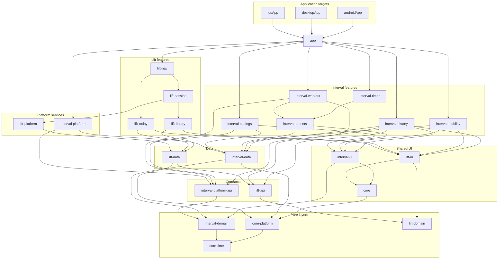
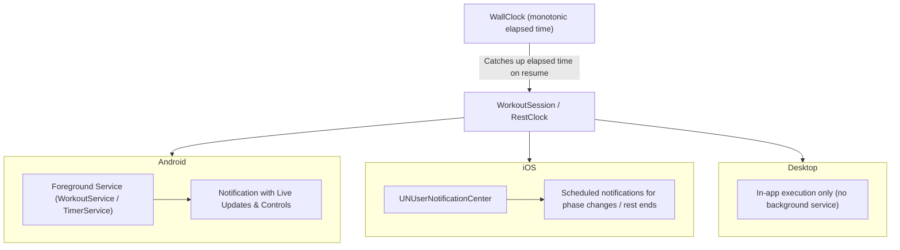

# Architecture

Interval is a Compose Multiplatform application for Android, iOS, and Desktop (JVM), built with the
[Kotlin Toolchain](https://kotlin-toolchain.org/0.13/) (Amper-based). The architecture emphasizes strict layer
separation, compile-time modularity, unidirectional data flow, and offline-first local persistence.

---

## High-Level Overview

The system is structured around two distinct workout domains unified within a shared application container:
1. **Interval**: Conditioning, mobility, and weekly planning engine (multi-block interval sequences, sets and ladders,
   guided mobility flows, natural language parser, sound/speech cues, `Today` agenda, routine and sport-day planning,
   and foreground execution).
2. **Lift**: Kettlebell and strength training engine (exercises, sets, EMOMs, hold clocks, rest alerts, built-in
   programs, session duration estimates, progression, muscle balance, PR records, an animated figure for every
   built-in lift, and coaching worked out from the sets logged: grip load, readiness, an easier day, density,
   challenges and lifetime totals).

At the container boundary (`app`), cross-domain features coordinate both sides without coupling them: guided first-run
and weekly `Set up` (`weeksetup/`), unified JSON export/import (`export/`), and `WeekStandingSource` for the Android and
iOS home-screen widgets.



Drawn from the modules themselves: `python3 tools/check_module_rules.py --diagram` reads every `module.yaml`
(templates expanded) and draws each module's `dependencies`, the testing modules and the build plugins left out,
reduced to the edges no other already implies (`app` lists `interval-domain`, say, but reaches it through
`interval-timer`; every Compose module takes `core` through its `-ui`). CI fails when this block and the modules
disagree; `--write-diagram` puts the current one here. The module table below says what each does.

---

## Architectural Principles

1. **Strict Dependency Rule**: Dependencies flow strictly downward from Application Targets → Shared Container →
   Features → Shared UI → Data → Domain. Lower layers have no knowledge of higher layers. CI enforces it with
   `tools/check_module_rules.py`, which reads every `module.yaml` (templates expanded) against a table of what
   each kind of module may depend on.
2. **Domain Decoupling**: The kettlebell domain (`lift-*`) has zero dependencies on the interval domain (`interval-*`),
   and the two domain modules know nothing of each other: History turns a Lift session into interval's `LiftWorkout`.
   Where cross-domain interaction is needed (e.g. History counting Lift sessions or Today showing workout recaps),
   it is mediated via minimal interfaces in `lift-api`: `IntervalActivity` (what Lift reads of the interval side,
   implemented in `app`) and `LiftActivity` (what History, Plan and the workout read of Lift, implemented by
   `SessionRepository`). The interval side depends on `lift-api`, never on `lift-data`.
   The same goes for the platform: the interval features take `interval-platform-api` (the cue player, the
   workout off screen, the plan's reminders), and only `app` sees `interval-platform`, which implements it. The
   platform draws nothing of the design system: the workout's notification takes its colours as ARGB
   (`StatusColors`, bound by the workout feature from `PhaseColors`).
3. **Pure Domains**: `interval-domain` and `lift-domain` contain only pure Kotlin models and calculation engines.
   They have no dependencies on Compose, Android, or third-party persistence libraries.
4. **Offline-First & Local-Only**: All user data resides on device. There is no remote backend, telemetry, or user
   account requirement. Complete user state can be backed up natively, or exported to versioned JSON and imported
   back (`ExportBundle.SCHEMA`).
5. **Multiplatform-First**: All feature code and screens are written in Compose Multiplatform. Platform-specific code
   (`expect`/`actual` or platform-specific interfaces) is kept behind injected abstractions.

### Known architectural debt & resolutions

The 2026-10-31 review ([architecture-review.md](architecture-review.md)) audited the architecture against lifecycle,
modularity, and data-correctness guidelines. [sprint-architecture.md](sprint-architecture.md) and sprint 0.3 resolved
several core issues:

- **Resolved — Container lifetime (A1)**: `initAppKoin` starts one Koin container per process from Android's `IntervalApplication`,
  desktop's `main`, and iOS's `AppDelegate` at launch (through `startWidgetFeed`). `KoinHolder`, main-thread `runBlocking`, and global DataStore maps have been eliminated;
  databases stay open across Activity restarts.
- **Resolved — ViewModels in Koin (C4)**: ViewModels are declared in their respective feature Koin modules (`<feature>/src/di/`)
  and resolved with `koinViewModel { parametersOf(id) }`. Positional `scope.get()` calls are removed, and `VerifyAppModulesTest`
  verifies the entire graph in CI.
- **Resolved — Atomic transactions & plan updates (E1, E2)**: `changeSessionPlan` applies plan edits atomically inside the writer,
  and multi-statement DAO operations (`finishActive`, `discardActive`, `deleteProgram`, `removeOrArchive`) run in `@Transaction` methods.
- **Resolved — Domain invariants & edge guards (E3, E5, E6, D5)**: `IntervalConfig` enforces ranges at construction and provides
  `sanitized()` factories for storage mappers. `reviewImport` fails gracefully on corrupted files, and preset flows are derived safely.
- **Resolved — Rest wake lock renewal (B4)**: the timers' service (now `TimerService`) renews the device wake lock
  on every run's countdown.
- **Resolved — Lift's timers owned by the process (B2, B5, F3)**: `SessionTimers`, a Koin single, runs the rest, the
  EMOM and the hold on monotonic time, logs as they go and keeps whichever runs alive through `SessionKeepAlive`
  (Android's `TimerService`, iOS's notification at its end). `SessionViewModel` starts them and shows their clocks
  apart from the rest of its state. They end with the session, its page or the task.
- **Resolved — The running workout owned by the process (B1, D2)**: `WorkoutSession`, a Koin single, runs the workout
  (the ticker, cues, course, checkpoint and the service's lifetime); `WorkoutService` and iOS's keeper reach it as
  the `ActiveWorkout` port, and `WorkoutViewModel` only maps its state. It ends when its page leaves the back stack.

- **Resolved — Narrow ports (C3)**: each side's storage plays roles a consumer takes one by one, each a
  repository of its own bound in Koin (C1, C2): the interval side's `SettingsStore`, `PresetStore`, `HistoryStore`, `PlanStore` and
  `WorkoutProgressStore` (`interval-data`'s `Stores.kt`), Lift's `SessionStore`, `SetStore`, `ProgramStore`,
  `ExerciseStore` and `GearStore` (`lift-data`'s). What only the app does (`ready`, `writeErrors`, `importAll`,
  `close`) stays on the repository, which the app shell, export, import and `PlanReminderScheduler` (it waits on
  `ready`) still take.

- **Resolved — `LiftRepository`, split (C1)**: one repository per store, each over the DAOs of its kind:
  `SessionRepository` (also the `LiftActivity` the interval side reads), `SetRepository`, `ProgramRepository`,
  `ExerciseRepository` and `GearRepository`, sharing one `SerialWriter` so writes of different kinds keep their
  order, with the mappers in `LiftMappers.kt`. `LiftRepository` is their root, what the app alone takes for `ready`,
  `writeErrors`, `importAll` and `close`; Koin binds each store to its repository.

- **Resolved — `IntervalRepository`, split (C2)**: the same shape on the interval side: `SettingsRepository` (the
  DataStore's settings and the workout under way), `PresetRepository`, `HistoryRepository` and `PlanRepository`,
  sharing one `SerialWriter`, with the mappers in `IntervalMappers.kt`. `IntervalRepository` is their root, for
  `ready`, `writeErrors`, `importAll` and `close`.

- **Resolved — `SessionViewModel`, split (D1, D3, F2; D4 in part)**: the Log sheet's draft is `SetDraftEditor`
  (pure: what it goes by is a function it reads at each change), today's plan `TodayPlanEditor`, and the finish and
  its summary `FinishSession`, whose health store copy outlives the summary (`SessionHealth`, a single, writes the
  summary's words once they settle rather than in `onCleared`). The ViewModel exposes the three (`draft`, `plan`,
  `summary`), which the Route's actions call, with the timers and `SetStore`'s remove and restore taken there
  straight. Its state is built from the stores' flows (`SessionInputs.kt`): the sets before this session are flattened on a
  computation dispatcher as the sessions change, and the records and recent lifts worked out as a set is logged,
  not at each tap on the sheet, which shows at once. It starts no session: whatever opens its page does
  (`SessionStore.startSession`: Train's Strength pillar, History, the launcher shortcut), and a page restored with no session
  behind it closes (`sessionGone`).

New code should not add to what these resolved: inject the stores it uses rather than a repository, keep new
long-running work out of `viewModelScope`, and give a ViewModel's parts classes of their own rather than functions.

---

## Module Architecture

The project contains 32 modules in five folders (`apps/`, `core/`, `interval/`, `lift/`, `tooling/`), configured via
[project.yaml](../project.yaml) and each module's `module.yaml`; `./kotlin show modules` describes each.
Each module applies a reusable template from `templates/`:
- `lib`: Standard Kotlin Multiplatform library with warnings-as-errors, ktlint, and detekt.
- `tested-lib`: Adds test dependencies and `core-testing`.
- `compose-lib`: Adds Compose Multiplatform, lifecycle, Koin compose, and resource accessors.
- `room-lib`: Configures Room KSP, bundled SQLite driver, and `-Xexpect-actual-classes`.

### Module Classification

| Layer | Modules | Responsibilities |
|---|---|---|
| **App Targets** | `androidApp`, `iosApp`, `desktopApp` | Platform entry points, manifests, splash/launch assets, packaging; Android's home-screen widget (Glance, `androidApp/src/widget/`) and launcher shortcuts; iOS Home Screen quick actions and widget (`iosApp/widget/`). |
| **Container** | `app` | Application entry (`App.kt`), Navigation 3 routing table and `Train` pillar host, Koin graph assembly, root theme host, `Set up` (`weeksetup/`), `WeekStandingSource`, `About`, and JSON export/import (`export/`). |
| **Core** | `core`, `core-platform`, `core-time`, `core-testing` | Design tokens (`Spacing`, `Radius`, `Sizes`, `Motion`), `IntervalTheme`, navigation primitives; the clocks, timestamp formatter, `HealthStore`, and storage utilities in `core-platform`, which has no Compose so the data modules (and their Room KSP) don't rebuild on a UI change; calendar and clock maths in `core-time`, which has no dependencies so the domains compile without Compose; UI test harness. |
| **Interval Domain & Data** | `interval-domain`, `interval-data`, `interval-platform-api`, `interval-platform` | Timer calculation engine, multi-block `Course`, mobility `Flow`s, `Sport` days, Room database (`AppDatabase`), DataStore preferences, audio/speech cues, Android Foreground Service, iOS notifications. |
| **Interval Features** | `interval-timer`, `interval-workout`, `interval-presets`, `interval-mobility`, `interval-history`, `interval-settings`, `interval-ui` | The Timer, active workout & flow screen, preset & block sequence editor, mobility flows, `Today` home tab, the Log (calendar & training log) & routine/sport-day planner, settings, shared workout components. |
| **Lift Domain & Data** | `lift-domain`, `lift-api`, `lift-data`, `lift-platform` | Kettlebell exercises, training programs, duration estimates, starter program selection, EMOM/hold/rest timers, each lift's `Movement` and the coaching read from it (grip, readiness, autoregulation, density, benchmarks), the ports to the interval side (`lift-api`), Room database (`LiftDatabase`); `Beeper` and `TimerService` keep-alive in `lift-platform`. |
| **Lift Features** | `lift-nav`, `lift-today`, `lift-session`, `lift-library`, `lift-ui` | Lift navigation registry, Train's Strength pillar (`TodayRoute`) & gear, active session logger & timers, exercise library & editor, shared Lift UI (its words, widgets and the exercise figures in `lift-ui`'s `demo/`). |
| **Test Fakes** | `interval-testing`, `lift-testing` | In-memory storage, recording cue players, fake DAOs, and mock platform services for tests. |
| **Toolchain Plugins** | `lint-plugin`, `detekt-plugin` | Kotlin Toolchain task plugins for ktlint formatting and Detekt static analysis. |

---

## Navigation Architecture (Navigation 3)

The application uses Jetpack Navigation 3 with a single, unified back stack hosted in `apps/app/src/App.kt`.

### Key Elements:

1. **Type-Safe Keys (`NavKey`)**:
   - Every destination is a `@Serializable` class or object implementing `NavKey` (e.g. `TodayTab`, `Timer`, `Settings`, `Workout(id)`, `WeekSetup`). `TodayTab` is the start destination and the root of the back stack: Back from any other tab returns to it. A new install's first plain open starts with `WeekSetup` (Set up) over it, once. Train is one item of the bar over three tabs, its pillars: Lift's `LiftTab` (Strength), `ConditioningTab` (the presets) and `MobilityTab` (the flows), each under the title "Train" and the picker between them (`apps/app/src/ui/Train.kt`). The Timer is a page pushed over Conditioning (`showTimer`), no longer a tab.
   - Lift keys live in `lift/lift-nav/src/nav/LiftRoutes.kt` (e.g. `LiftTab`, `Lifting`, `LiftDetail(uid)`).
   - Tabs implement the `Tab` interface (`core/core/src/nav/Tab.kt`), which provides the `push` helper.
2. **Polymorphic Serialization**:
   - Because the back stack is saved across configuration changes and process recreations, all keys must be registered in
     `navConfiguration` in `App.kt` using `subclass(X::class)` or `liftRoutes()`.
3. **Entry Provider (`entryProvider`)**:
   - Binds each `NavKey` to its composable route (`entry<X> { XRoute() }`).
   - Lift destinations are registered in modular fashion via `liftEntries` (`lift/lift-nav/src/nav/LiftEntries.kt`).
4. **Adaptive Shell, Pillar Swaps & Predictive Back**:
   - `NavigationAreaBar` (`core/core/src/ui/NavigationArea.kt`) renders a bottom navigation bar on mobile phones and shifts to a
     navigation rail on tablets and wide desktop windows; on wide windows `Settings` still opens beside the `Timer` (`settingsOverTimer`).
   - Moving between Train's three pillars cross-fades content in place (`pillarSwap` over a shared `tabGroup`) while keeping the title and `PillarPicker` steady.
   - Pushed pages render with predictive back gestures (`backPreviewTransition`, `backPreviewCorners`), sliding the
     underlying tab smoothly into view.
5. **App Shortcuts, Home-Screen Widget & Launcher Intent Routing**:
   - Android launcher shortcuts ("Start a workout" and "Start a Lift session", declared in `shortcuts.xml`) and the Glance home-screen widget's action buttons (`WeekWidget`) route through
     a dedicated `ShortcutActivity` that passes a `Shortcut` enum into `MainActivity` with `SINGLE_TOP | CLEAR_TOP`.
   - iOS's Home Screen quick actions are the same two (`UIApplicationShortcutItems` in `Info.plist`, each type a
     `Shortcut.id`): `SceneDelegate` hands the type to `openShortcut` (`ViewController.kt`) from the scene's
     connection options at a cold launch and from `windowScene(_:performActionFor:)` with the app running.
   - `App(shortcut: Shortcut?, onShortcutOpen: () -> Unit)` inspects the shortcut: if a workout is already in progress,
     it preserves it; otherwise it navigates directly to the target tab and pushes the requested action.

---

## Presentation & State Architecture

Interval strictly follows unidirectional data flow (UDF) with a clean separation between stateful routing and
stateless presentation:

```
[ Domain Flow / Repository ]
           │
           ▼
     [ ViewModel ]  (emits StateFlow<UiState>)
           │
           ▼
      [ XRoute ]    (resolves its ViewModel with koinViewModel(), collects state, handles nav events)
           │
           ▼
     [ XScreen ]    (pure, stateless Composable taking state + callbacks)
```

### The Route / Screen Pattern:
- **`XRoute`**:
  - Entry-scoped via `rememberViewModelStoreNavEntryDecorator`.
  - Resolves its ViewModel with `koinViewModel<XViewModel>()` (`{ parametersOf(id) }` for a route's key), declared
    in the feature's own Koin module (`<feature>/src/di/`); anything else it needs with `koinInject()`.
  - Collects `StateFlow<UiState>` using `collectAsStateWithLifecycle()`.
  - Passes state down to `XScreen` and wires UI callbacks to ViewModel events or navigation `push`/`pop`.
- **`XScreen`**:
  - Stateless `@Composable` taking immutable state data and callback lambdas (`onClick`, `onUpdate`).
  - Contains no direct references to ViewModels, Koin, or navigation controllers.
  - Can be rendered in `@Preview`, Compose Hot Reload, or offscreen desktop tests (`test@jvm`) with zero mocks.

---

## Persistence & Storage Architecture

Data persistence is split between Room (structured relational records) and DataStore Preferences (app settings).
All disk I/O is encapsulated behind repositories.

### 1. Relational Storage (Room Multiplatform)
- **`AppDatabase`** (`interval-data`, version 15):
  - Stores workout history (`HistoryEntity`, including multi-block `thenBlocks` JSON), custom presets (`PresetEntity`, with `alternateHands` since version 15), planned routines and sport days (`PlannedEntity`), logged sport days (`SportLogEntity`), and the user's own mobility flows (`FlowEntity`, the `flow` table since version 14, its moves one JSON column).
  - Uses bundled SQLite (`sqlite-bundled`) and Room KSP generation for common code.
- **`LiftDatabase`** (`lift-data`, version 17):
  - Stores logged lifting sessions (including `SavedTimer` checkpoints), set details (`lift_set` with `ON DELETE CASCADE` to `session`), personal records, custom exercises, followed programs, and gear inventory (the bells owned, each marked when owned as a pair since version 17).
- **Migration & Schemas**:
  - Every schema version bumps `@Database(version = N)` and adds a strictly validated migration.
  - Exported schema JSON files reside in `interval/interval-data/schemas/` and `lift/lift-data/schemas/`.
  - Migration tests (`AppMigrationTest`, `LiftMigrationTest`, `StorageTest`) verify that earlier database versions migrate losslessly.

### 2. Preferences Storage (DataStore)
- App configuration (theme mode, cue sounds, speech options, countdown times, body weight, preferred `sessionMinutes`, `setupOffered`, and `WorkoutProgress` checkpoints) is stored in DataStore Preferences.
- Held in memory for instant read access and serialized in the background via `SerialWriter` (`core/core-platform/src/storage/Storage.kt`),
  preventing UI stalls and race conditions.

### 3. Backup & JSON Data Portability
- **Android System Backup**: Full cloud backup and device-to-device migration configured via Android Backup rules.
- **JSON Export & Import (`ExportBundle.SCHEMA = 10`)**:
  - **Export**: Settings > Your data > Export bundles the entire database (workouts, multi-block presets, planned routines and sport days, logged sport days, settings including `sessionMinutes`, the user's own flows (schema 8),
    presets that switch hands and the bells owned in pairs (schema 9), a program block's own rest (schema 10),
    Lift sessions, programs, exercises, and gear) into a single validated JSON document sharable via system share.
  - **Import**: Settings > Your data > Import parses exported files across schema versions 1 to 10 via `AppDataImporter`
    and `ImportPlanner`. It inspects the file, checks schema compatibility, rejects corrupted or newer versions,
    strictly validates all domain ranges, prevents duplicates, assigns clean local IDs, and commits changes in atomic
    Room transactions (`ImportDao`, `SerialWriter.await`). Settings are imported optionally on user confirmation (marking `setupOffered` so an imported backup isn't prompted for first-run setup).

---

## Platform Integration & Background Execution

Interval keeps timing accurate even when the app is placed in the background, suspended, or the device is locked.



- **Monotonic Time Accounting**: `WorkoutSession` (through `WorkoutTicker`) and Lift's `SessionTimers` (through a `RunClock`) calculate time against real elapsed time
  (`realElapsedTime`). Even if the process sleeps or is delayed, resuming ticks forward precisely without lost seconds.
- **Android**:
  - `WorkoutService` runs as a foreground service with a persistent notification (`specialUse` type) allowing the user
    to view current intervals and tap Pause or End directly from the lock screen. It injects the process's
    `ActiveWorkout` (the `WorkoutSession`), shows its `status` and acts on it; nothing is shared through statics.
  - **Live Updates (Android 16+)**: Built with `NotificationCompat.ProgressStyle` and `setRequestPromotedOngoing(true)`.
    Promotes an active workout to a compact chip with clock countdown in the status bar, and displays a phase-colored
    progress bar (per interval, per set, or per block within the system's 10-segment cap) on the lock screen and notification shade.
  - `TimerService` keeps Lift's rest, EMOM or hold counting with the screen off: a Live Update naming the run
    ("Resting", "EMOM · minute 2 of 10", "Holding"), a wake lock to each run's end, while `SessionTimers` beeps.
  - **Home-Screen Widget (`WeekWidget`)**: Glance widget in `apps/androidApp/src/widget/` backed by `WeekStandingSource`
    (combining interval workouts, mobility flows, sport days, and Lift sessions), drawing the progress ring in `PhaseColors`,
    turning the day at local midnight via `WidgetDayAlarm`, and publishing a rendered sample preview to Android 15+ widget pickers (`WidgetPreview`).
- **iOS**:
  - Rather than maintaining power-draining background audio sessions, iOS schedules local notifications (`UNUserNotificationCenter`)
    in advance for each upcoming interval or rest expiration. Returning to the app cancels remaining scheduled alerts.
  - Plan reminders display in-app banner alerts if due while the app is foregrounded (`UNUserNotificationCenterDelegate` in `iosApp.swift`).
  - **Home Screen widget (`WeekWidget.swift`)**: a Swift-only WidgetKit extension, the Xcode project's second target
    (`apps/iosApp/widget/`; the toolchain allows one target with its Kotlin build phase, so the extension links no
    Kotlin). The app writes each `WeekStandingSource` standing as a `WeekSnapshot` JSON (`apps/app/src/data/`) to the
    App Group `group.dev.justinsmith.interval` (`WidgetFeed.kt`, iosApp) and has `WidgetCenter` redraw; the widget's
    timeline turns the week at Monday's midnight itself. Its Workout and Lift links (`interval://shortcut/<id>`) go
    through `SceneDelegate` to `openShortcut`, as the quick actions do. Both targets carry the same version
    (`tools/check_versions.py`).
- **Plan Reminders (`PlanReminderScheduler`)**:
  - Recomputes the next 14 days with open plans (`plannedReminders` from `TrainingLog.upNext`) on plan/history changes and at midnight.
  - Android arms one inexact alarm per day (`PlanAlarms`), and `PlanReminderReceiver` words the notification at delivery (`PlanReminderSource`) and extends the 14-day window even when the app hasn't been opened (as well as across reboots and clock changes); iOS schedules calendar-triggered local notifications while reserving slots for active workout alerts.
- **Courses, Sets, Ladders & Warm-Up/Cool-Down Phases**:
  - `IntervalConfig` supports optional `warmUpSeconds` and `coolDownSeconds`. The workout engine runs them in sequence
    (`GetReady` → `WarmUp` → blocks/sets/rounds → `CoolDown`).
  - `Course.of(config)` (`interval-domain`, `timer/Course.kt`) lays out every `Interval` (phase, block, set, round,
    seconds) once from the config: the bookends around `IntervalConfig.blocks` (a `Block` is work, rest, rounds, sets,
    set rest and ladder: the config's own fields are the first, `IntervalConfig.then` those after it, and between
    two blocks comes a `Phase.SetRest` of `blockRestSeconds`, or the block's ordinary rest when that is 0;
    `IntervalConfig.isBlockRest` tells it from a set's, for the words, the cue and the notification). Each of a
    block's sets is its rounds with their rests, and a `Phase.SetRest` of `setRestSeconds` follows every set but the
    last (a set rest of 0 is the ordinary rest); on a ladder each round works its own `Block.workOf(round)`,
    `workStepSeconds` more than the one before, starting over with each set. The engine walks it by (block, set, round, phase), the place
    `WorkoutState` holds: `advance`, Back, `sessionRemainingMillis` and `upcomingChanges` read it, as do
    `WorkoutOutline`, the `Timeline`, `totalSeconds`, the calorie fallback and the readout's counts
    (`Course.workBehind`, the block's own rounds and sets). Nothing else works out a workout's length from its fields.
    Every store keeps the blocks after the first as one JSON list (`BlocksJson.kt` in interval-data: Room's
    `then_blocks` column since version 12, the settings' `then_blocks` key, the saved workout) and the export as
    `ConfigExport.then` (schema 5); a sequence is described block by block ("…, then …", `ConfigText`).
  - Bookends and set/block rests are visually distinguished in the timeline, announced by spoken/audio cues, tracked in Live Updates,
    and written as distinct exercise activity spans to Health Connect and Apple Health.
- **Guided Mobility Flows (`Flow`)**:
  - A `Flow` (`interval-domain`, `timer/Flow.kt`) is an ordered list of timed `Move`s (optional left/right `sided` execution and one-line form cues) that compiles into a multi-block `IntervalConfig` (`Flow.config`, with `Activity.Mobility`, 10s between moves, and 5s between sides).
  - `FlowStore.flows` holds the shipped flows (`builtInFlows`) then the user's own (`FlowRepository`, built in `FlowEditor` from the library's mat moves and floor holds or moves typed in, or copied from a shipped one with "Make it yours"). Because no two flows share a shape (`FlowTest` for the shipped ones, `FlowDraft.clash` refusing a draft that matches any flow or preset), `WorkoutSession`, `SpeechQueue` (`Speech.NextMove`, `LeftSide`, `SwitchSides` with halfway warnings suppressed), `FlowStatusText` notifications, and the Log identify a run from its `IntervalConfig` (`flows.matching(config)`), so nothing about a run is stored, and sync them to Health Connect and Apple Health as stretching (`HealthWorkoutKind.Mobility`).
- **Sport Days, `Today` Agenda & Guided `Set up`**:
  - Off-app training (`Sport`: BJJ, Climbing, Running, or custom) is planned via `PlanWorkout.SportDay` and logged per calendar day via `HistoryStore.logSport`, counting toward `TrainingLog`, `WeekStandingSource`, and `IntervalActivity.sportDays` without counting unlogged days as missed workouts.
  - `todayAgenda` (`interval-history`) orders what `Today` leads with: on an unlogged sport day with no user-planned workout, it leads with a pre-class mobility flow (`flowBefore`) until mobility is completed that day, then the sport day itself, placing an unplanned followed-program day under `AlsoToday`.
  - `WeekSetup` (`apps/app/src/weeksetup/`) combines pure `starterProgram` (`lift-domain`, choosing a fitting `Program.oneBell`, or with a pair of bells owned `Program.pairOfBells`, within `sessionMinutes`; a grappler's first for BJJ, with a pair `BjjKettlebell`) and `buildWeek` (`BuiltWeek.kt`) to populate `PlanStore`, `SettingsStore`, `GearStore`, and `ProgramStore` in one step, offered once on a clean install (`FirstRun.kt`).
- **Finish Reflection ("How was it?")**:
  - Finished interval workouts and Lift sessions prompt a lightweight reflection row (`HowWasIt` in `core`): a 5-level
    perceived effort scale (`PerceivedEffort`: Easy, Steady, Hard, Very hard, All out) and an optional note.
  - Saved immediately to database records, preserved in JSON exports, and updated in Health Connect and Apple Health session notes
    using versioned updates (`clientRecordVersion` / `HKMetadataKeySyncVersion`).
- **Muscle Balance & Duration Estimates (Lift)**:
  - `MuscleBalance` (`lift-domain`) analyzes logged lifting sessions across a rolling 28-day window, aggregating sets
    into seven major muscle groups (chest, shoulders, back, arms, core, glutes & hamstrings, quads & calves).
  - Differentiates primary working sets from assisting sets (`Opacity.LIGHT_SHARE`) and identifies unworked muscle groups
    in `BalanceBars` (`lift-ui`), which Strength's `BalanceCard` (`lift-today`) and a program's sheet draw.
  - `MuscleBalance.ofSets` folds any sets, so `Program.weekBalance()` counts what a week of a program plans the same
    way; `ProgramCoverageTest` holds what each built-in leaves untrained.
  - `Estimate.kt` (`lift-domain`) estimates each program day's duration from set/rep counts, movement pace, EMOM minutes, a density block's cap, and configured set rest.
- **Coaching (Lift)**, all in `lift-domain`, all worked out from the sets logged with nothing new stored
  (the reasoning: [kettlebell-coaching.md](kettlebell-coaching.md)):
  - `Movement.kt` gives every built-in lift its pattern (hinge, squat, press, …), tempo (ballistic, grind, hold), grip
    and lifts in a rep; a custom lift's is worked out from its equipment.
  - `Grip.kt` weighs each set on the hands (ballistic and two-bell sets heavier, a logged BJJ day a fixed load) and
    compares the week against the four before; `Readiness.kt` reads the last session's effort, BJJ and the grip
    into Fresh, Normal or Taxed, and `Autoregulate.kt` offers a taxed day an easier plan (`SessionPlan.easier`)
    or the program's day lighter on the grip (`Program.lighterDayThan`), never imposed.
  - `Density.kt` reads reps a minute from sets logged as they were done; where the next bell is a big jump, a
    block's own rest (`Block.rest`) shortens before the bell goes up, and a best pace is a record.
  - `Benchmarks.kt` works out the challenges (10,000 swings, the snatch test, the ABC's best twenty minutes, a
    get-up at body weight) shown in `lift-today`'s `ChallengesCard`, and each lift's lifetime reps and milestones.
- **Exercise figures (Lift)**: `lift-ui`'s `demo/` draws every built-in lift as a figure seen from the side
  (`ExerciseFigure`, joint angles per `ExerciseDemo` pose, the bell turning with the hand), keyed by `Exercise.demo`.
  `rememberDemoPlayer` sets up once then loops the reps, standing still under `prefersReducedMotion()`;
  `DemoTimeline` scrubs a rep's parts beside its cues on an exercise's page (`lift-library`), and the session's
  set card shows the next lift's (`lift-session`).
- **Audio & Cues**:
  - Audio cues are managed by `CuePlayer` (interval) and `Beeper` (Lift).
  - Voice is one `Speaker` per process (`core-platform`: Android's text-to-speech, iOS's speech synthesizer, none on
    desktop), bound in `corePlatformModule`. Each side puts its own lines into words through `SpokenLines`: the
    interval side's `Speech` in `SpeechQueue`, Lift's `Coaching` (a lift's cue at an EMOM count-in and a rest's end,
    a fault after a set) in `SpokenCoaching`. Settings' Voice switch governs both (Lift reads it as
    `IntervalActivity.voice`).
- **Health store** (`HealthStore`, `core-platform`):
  - As a workout or a Lift session finishes, its ViewModel hands the store a `HealthWorkout`: when it ran, a segment
    per interval, rest, pause or set (the workout's course is kept as `CourseSpan`s in `WorkoutProgress`, so a
    process killed mid-workout loses none of it), and the calorie estimate.
  - Android's `HealthConnectStore` writes it to Health Connect as an exercise session and a total-calories record,
    keyed by the workout's id so a repeated write replaces rather than doubles, and only while the user has
    connected it in Settings (the permission sheet is Health Connect's, opened through `rememberHealthConnector`).
    iOS's `HealthKitStore` writes it to Apple Health through a `HKWorkoutBuilder` dated to when it ran: a stretch
    (an activity of the workout's own kind, its move and reps in its metadata) per interval, rest or set, a pause
    and a resume per pause, and an active-energy sample, the workout and the sample each under a sync identifier
    and version, so a later write replaces. iOS has no revoke: Settings' switch off is the app's own, kept in the
    user defaults; connecting asks HealthKit's sheet only what it hasn't asked, and a user who refused the
    writes is sent to the Health app. Desktop has `NoHealthStore`, and Settings shows no row. Every screen names
    the store by core's `healthStoreName` ("Health Connect", "Apple Health"), as resources have no platform
    qualifier.
  - It reads two things back. `latestWeightKg`, the last weight weighed in the past 30 days by any app: Settings'
    weight sheet offers it as a button ("Use Health Connect's: 82 kg", "Use Apple Health's" on iOS) and never takes it on its own. And
    `heartRate(start, end)`, a watch's average and peak over a finished workout or session: the summary and the
    finished one's page read it each time they come into view (`LifecycleStartEffect`) until one is found, since
    Health Connect answers only an app on show and a watch syncs late, and keep it on the History entry or the
    session (`average_bpm`, `peak_bpm`, the first found stays). Being connected means the write permissions; each
    read is asked on the same sheet but checked on its own, so a user who refuses one, or connected before the app
    asked, still has their workouts written.

---

## Design System & Theming

The visual identity is defined in `core/core/src/ui/`:
- **Fixed Tokens** (`Tokens.kt`):
  - `Spacing`: 4dp grid (`space4`, `space8`, `space12`, `space16`, `space20`, `space24`, `space32`).
  - `Radius` & `Corners`: `radius12` (controls), `radius18` (cards), `radius24` (sheets), `full` (progress caps).
  - `Sizes`: Consistent dimensions for steppers, chips, timelines, and touch targets.
- **Dynamic Theming** (`Theme.kt`, `PhaseColorsOf.kt`):
  - `IntervalTheme`: Supports Light, Dark, and System default modes.
  - `PhaseColors`: Semantic colors representing workout states (Get Ready = Amber, Work = Coral/Red, Rest = Mint/Green).
- **Motion System** (`Motion.kt`):
  - Micro-interactions: `pressScale` for button presses, `enterRising` for list item entry, `RollingText` for animated number transitions.
  - Accessibility: `prefersReducedMotion()` is respected for all looping animations and particle effects.
- **Assets & Icons**:
  - Adaptive app icons and launch marks are generated via `tools/generate_icons.py`, matching the vector geometry of
    `IntervalMark.kt` in the launch splash screen.
