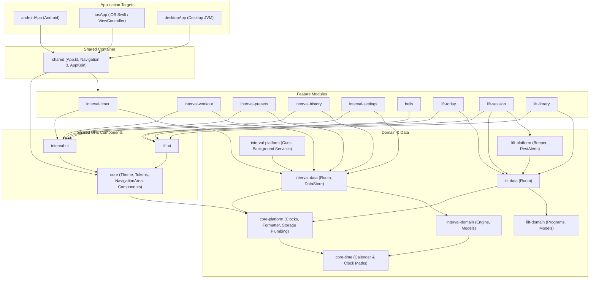
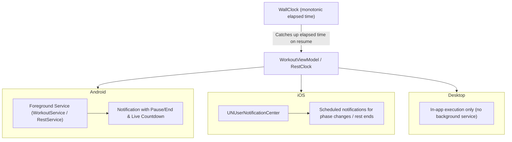

# Architecture

Interval is a Compose Multiplatform application for Android, iOS, and Desktop (JVM), built with the
[Kotlin Toolchain](https://kotlin-toolchain.org/latest/) (Amper-based). The architecture emphasizes strict layer
separation, compile-time modularity, unidirectional data flow, and offline-first local persistence.

---

## High-Level Overview

The system is structured around two distinct workout domains unified within a shared application container:
1. **Interval**: Cardio and interval timer engine (work/rest/rounds, natural language parser, sound/speech cues,
   routine planning, and foreground execution).
2. **Bells**: Kettlebell and strength training engine (exercises, sets, EMOMs, hold clocks, rest alerts, built-in
   programs, progression, and PR records).



---

## Architectural Principles

1. **Strict Dependency Rule**: Dependencies flow strictly downward from Application Targets → Shared Container →
   Features → Shared UI → Data → Domain. Lower layers have no knowledge of higher layers.
2. **Domain Decoupling**: The kettlebell domain (`lift-*`) has zero dependencies on the interval domain (`interval-*`).
   Where cross-domain interaction is needed (e.g. History counting Lift sessions or Today showing workout recaps),
   it is mediated via minimal interfaces in `lift-data`: `IntervalActivity` (what Lift reads of the interval side,
   implemented in `app`) and `LiftActivity` (what History, Plan and the workout read of Lift, implemented by
   `BellsRepository`).
3. **Pure Domains**: `interval-domain` and `lift-domain` contain only pure Kotlin models and calculation engines.
   They have no dependencies on Compose, Android, or third-party persistence libraries.
4. **Offline-First & Local-Only**: All user data resides on device. There is no remote backend, telemetry, or user
   account requirement. Complete user state can be backed up natively or exported to JSON (schema 1).
5. **Multiplatform-First**: All feature code and screens are written in Compose Multiplatform. Platform-specific code
   (`expect`/`actual` or platform-specific interfaces) is kept behind injected abstractions.

---

## Module Architecture

The project contains 29 modules in five folders (`apps/`, `core/`, `interval/`, `lift/`, `tooling/`), configured via
[project.yaml](../project.yaml) and each module's `module.yaml`; `./kotlin show modules` describes each.
Each module applies a reusable template from `templates/`:
- `lib`: Standard Kotlin Multiplatform library with warnings-as-errors, ktlint, and detekt.
- `tested-lib`: Adds test dependencies and `core-testing`.
- `compose-lib`: Adds Compose Multiplatform, lifecycle, Koin compose, and resource accessors.
- `room-lib`: Configures Room KSP, bundled SQLite driver, and `-Xexpect-actual-classes`.

### Module Classification

| Layer | Modules | Responsibilities |
|---|---|---|
| **App Targets** | `androidApp`, `iosApp`, `desktopApp` | Platform entry points, manifests, splash/launch assets, packaging. |
| **Container** | `app` | Application entry (`App.kt`), Navigation 3 routing table, Koin graph assembly, root theme host. |
| **Core** | `core`, `core-platform`, `core-time`, `core-testing` | Design tokens (`Spacing`, `Radius`, `Sizes`, `Motion`), `IntervalTheme`, navigation primitives; the clocks, timestamp formatter and storage utilities in `core-platform`, which has no Compose so the data modules (and their Room KSP) don't rebuild on a UI change; calendar and clock maths in `core-time`, which has no dependencies so the domains compile without Compose; UI test harness. |
| **Interval Domain & Data** | `interval-domain`, `interval-data`, `interval-platform` | Timer calculation engine, Room database, DataStore preferences, audio/speech cues, Android Foreground Service, iOS notifications. |
| **Interval Features** | `interval-timer`, `interval-workout`, `interval-presets`, `interval-history`, `interval-settings`, `interval-ui` | Timer tab, active workout screen, preset management, history calendar & routines plan, settings, shared workout components. |
| **Lift Domain & Data** | `lift-domain`, `lift-data`, `lift-platform` | Kettlebell exercises, training programs, EMOM/hold timers, Room database; the EMOM beeper and rest alert services in `lift-platform`. |
| **Lift Features** | `lift-nav`, `lift-today`, `lift-session`, `lift-library`, `lift-ui` | Lift navigation registry, Lift tab & gear, active session logger & timers, exercise library & editor, shared Lift UI. |
| **Test Fakes** | `interval-testing`, `lift-testing` | In-memory storage, recording cue players, fake DAOs, and mock platform services for tests. |
| **Toolchain Plugins** | `lint-plugin`, `detekt-plugin` | Kotlin Toolchain task plugins for ktlint formatting and Detekt static analysis. |

---

## Navigation Architecture (Navigation 3)

The application uses Jetpack Navigation 3 with a single, unified back stack hosted in `apps/app/src/App.kt`.

### Key Elements:

1. **Type-Safe Keys (`NavKey`)**:
   - Every destination is a `@Serializable` class or object implementing `NavKey` (e.g. `TimerTab`, `Settings`, `Workout(id)`).
   - Lift keys live in `lift/lift-nav/src/nav/LiftRoutes.kt` (e.g. `LiftTodayTab`, `ExerciseDetail(id)`).
   - Tabs implement the `Tab` interface (`core/core/src/nav/Tab.kt`), which provides the `push` helper.
2. **Polymorphic Serialization**:
   - Because the back stack is saved across configuration changes and process recreations, all keys must be registered in
     `navConfiguration` in `App.kt` using `subclass(X::class)` or `liftRoutes()`.
3. **Entry Provider (`entryProvider`)**:
   - Binds each `NavKey` to its composable route (`entry<X> { XRoute() }`).
   - Lift destinations are registered in modular fashion via `liftEntries` (`lift/lift-nav/src/nav/LiftEntries.kt`).
4. **Adaptive Shell & Predictive Back**:
   - `NavigationAreaBar` (`core/core/src/ui/NavigationArea.kt`) renders a bottom navigation bar on mobile phones and shifts to a
     navigation rail on tablets and wide desktop windows.
   - Pushed pages render with predictive back gestures (`backPreviewTransition`, `backPreviewCorners`), sliding the
     underlying tab smoothly into view.

---

## Presentation & State Architecture

Interval strictly follows unidirectional data flow (UDF) with a clean separation between stateful routing and
stateless presentation:

```
[ Domain Flow / Repository ]
           │
           ▼
     [ ViewModel ]  (emits StateFlow<UiState>)
           │
           ▼
      [ XRoute ]    (retrieves ViewModel via currentKoinScope(), collects state, handles nav events)
           │
           ▼
     [ XScreen ]    (pure, stateless Composable taking state + callbacks)
```

### The Route / Screen Pattern:
- **`XRoute`**:
  - Entry-scoped via `rememberViewModelStoreNavEntryDecorator`.
  - Injects dependencies via `currentKoinScope().get()` or `viewModel { ... }`.
  - Collects `StateFlow<UiState>` using `collectAsStateWithLifecycle()`.
  - Passes state down to `XScreen` and wires UI callbacks to ViewModel events or navigation `push`/`pop`.
- **`XScreen`**:
  - Stateless `@Composable` taking immutable state data and callback lambdas (`onClick`, `onUpdate`).
  - Contains no direct references to ViewModels, Koin, or navigation controllers.
  - Can be rendered in `@Preview`, Compose Hot Reload, or offscreen desktop tests (`test@jvm`) with zero mocks.

---

## Persistence & Storage Architecture

Data persistence is split between Room (structured relational records) and DataStore Preferences (app settings).
All disk I/O is encapsulated behind repositories.

### 1. Relational Storage (Room Multiplatform)
- **`AppDatabase`** (`interval-data`):
  - Stores workout history (`HistoryEntity`), custom presets (`PresetEntity`), and planned routines (`PlannedEntity`).
  - Uses bundled SQLite (`sqlite-bundled`) and Room KSP generation for common code.
- **`BellsDatabase`** (`lift-data`):
  - Stores logged lifting sessions, set details, personal records, custom exercises, followed programs, and gear inventory.
- **Migration & Schemas**:
  - Every schema version bumps `@Database(version = N)` and adds a strictly validated migration.
  - Exported schema JSON files reside in `interval/interval-data/schemas/` and `lift/lift-data/schemas/`.
  - Migration tests (`AppMigrationTest`, `BellsMigrationTest`) verify that earlier database versions migrate losslessly.

### 2. Preferences Storage (DataStore)
- App configuration (theme mode, cue sounds, speech options, countdown times, body weight) is stored in DataStore Preferences.
- Held in memory for instant read access and serialized in the background via `SerialWriter` (`core/core-platform/src/storage/Storage.kt`),
  preventing UI stalls and race conditions.

### 3. Backup & JSON Data Portability
- **Android System Backup**: Full cloud backup and device-to-device migration configured via Android Backup rules.
- **JSON Export (Schema 1)**: Settings > Your data > Export bundles the entire user history, presets, settings, and Lift
  database into a single validated JSON document sharable via the system share sheet.

---

## Platform Integration & Background Execution

Interval keeps timing accurate even when the app is placed in the background, suspended, or the device is locked.



- **Monotonic Time Accounting**: `WorkoutViewModel` and `RestClock` calculate time steps against real elapsed time
  (`realElapsedTime`). Even if the process sleeps or is delayed, resuming ticks forward precisely without lost seconds.
- **Android**:
  - `WorkoutService` runs as a foreground service with a persistent notification (`specialUse` type) allowing the user
    to view current intervals and tap Pause or End directly from the lock screen.
  - `RestService` maintains countdown awareness during Lift rest periods, beeping via the device audio subsystem when
    the rest concludes.
- **iOS**:
  - Rather than maintaining power-draining background audio sessions, iOS schedules local notifications (`UNUserNotificationCenter`)
    in advance for each upcoming interval or rest expiration. Returning to the app cancels remaining scheduled alerts.
- **Audio & Cues**:
  - Audio cues are managed by `CuePlayer` (interval) and `Beeper` (bells).
  - Voice cues use system text-to-speech queues (`SpeechQueue`) with localized strings.

---

## Design System & Theming

The visual identity is defined in `core/core/src/ui/`:
- **Fixed Tokens** (`Tokens.kt`):
  - `Spacing`: 4dp grid (`space4`, `space8`, `space12`, `space16`, `space20`, `space24`, `space32`).
  - `Radius` & `Corners`: `radius12` (controls), `radius18` (cards), `radius24` (sheets), `full` (progress caps).
  - `Sizes`: Consistent dimensions for steppers, chips, timelines, and touch targets.
- **Dynamic Theming** (`Theme.kt`, `PhaseColorsOf.kt`):
  - `IntervalTheme`: Supports Light, Dark, and System default modes.
  - `PhaseColors`: Semantic colors representing workout states (Get Ready = Amber, Work = Coral/Red, Rest = Mint/Green).
- **Motion System** (`Motion.kt`):
  - Micro-interactions: `pressScale` for button presses, `enterRising` for list item entry, `RollingText` for animated number transitions.
  - Accessibility: `prefersReducedMotion()` is respected for all looping animations and particle effects.
- **Assets & Icons**:
  - Adaptive app icons and launch marks are generated via `tools/generate_icons.py`, matching the vector geometry of
    `IntervalMark.kt` in the launch splash screen.
