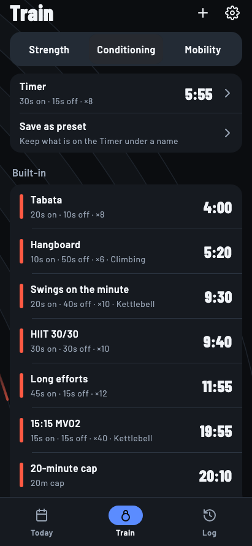
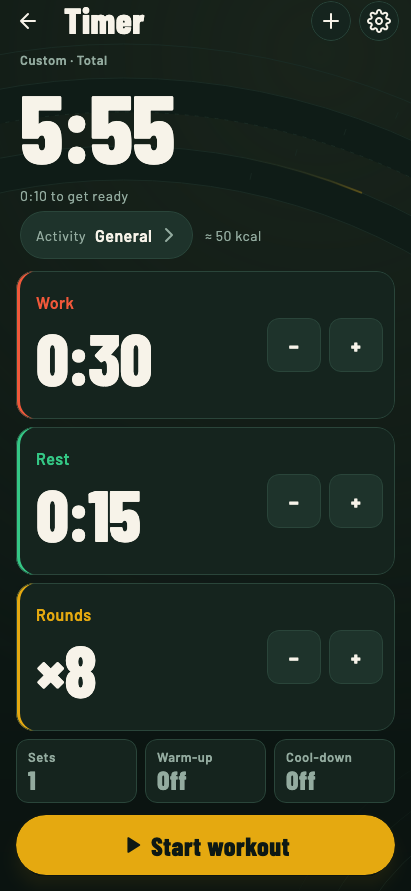
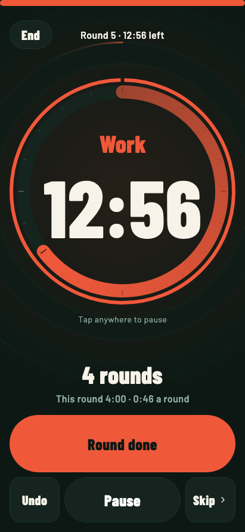
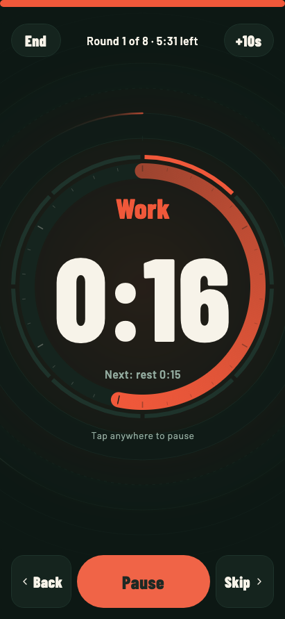
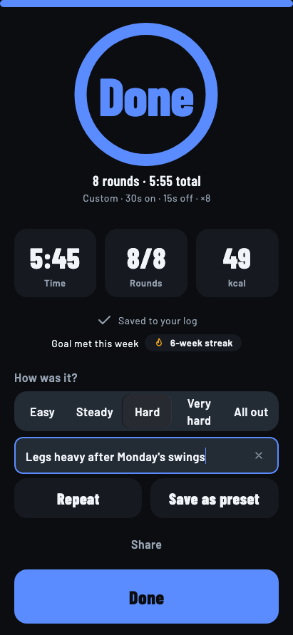

# Conditioning & the Timer

Train's **Conditioning** pillar lists the presets, shortest first, with a row at the top that opens **the Timer**
and says what's on it.

<figure markdown><figcaption>Presets, shortest first</figcaption></figure>
<figure markdown><figcaption>The Timer</figcaption></figure>
<figure markdown><figcaption>A time cap running</figcaption></figure>
<figure markdown><figcaption>The workout</figcaption></figure>
<figure markdown><figcaption>The summary</figcaption></figure>

## The Timer

Set work, rest and rounds, and it shows the
total and a calorie estimate (with your weight set). Beyond that:

**Sets of rounds**
:   Rounds grouped into sets with rest between sets: `4 × (8 × 20/10)`, a
    minute between.

**Ladders**
:   Work climbing or falling each round (`+10s` or `-5s` a round), starting over each set.

**Sequences**
:   Blocks one after another, each with its own work, rest, rounds, sets and ladder, and rest between blocks.
    Build one in the block editor or straight from the Timer.

**Time caps**
:   As many rounds as you can in so many minutes: on Work's sheet, or any block of a sequence
    (`10 min cap, 2 min rest, 10 min cap`). Tap **Round done** as each round ends; the rounds roll up with the
    round under way's pace beside the average and your best of the same workout. Five minutes and one minute
    left are called, and the end says *Time. 14 rounds.*

**Warm-up and cool-down**
:   Before the rounds and after, on the Timer or in a preset.

## Presets

Built in: *Tabata*, *HIIT 30/30*, *Hangboard*, *Long efforts*, *Swings on the minute*, *Mat rounds*, Kenneth
Jay's *15:15 MVO2* kettlebell snatch protocol, and a *20-minute cap*, each previewed with an interval waveform and
grouped by where it fits. Save your own, single blocks or sequences, from the Timer, or put any preset
**on the Timer** to change it for today.

A kettlebell preset can say *Switch hands. Work* at every work after the first (15:15 MVO2 does). Its summary
asks about how many snatches a set and the bell, which Lift counts with its own sets.

## The workout

The chronograph ring, the phase, the clock, the round and what comes next, with **Back** and **Skip** either side
of **Pause** and **+10s** at the top. In an interval's last seconds the clock pulses and the ring swells. Cues:

- **Tones**: the app's own, short and clean, for a countdown, work, rest and the finish.
- **Voice**: set numbers, blocks, rest between sets and blocks, the halfway point.
- **Vibration**, under the Vibrate switch, which plays with the screen off.

It keeps running with the screen off and the app away. On Android 16 it's a Live Update in the status bar with
Pause and End; on iOS a Live Activity on the Lock Screen and in the Dynamic Island with Pause or Resume and End,
plus a notification at each change ahead. With a heart-rate sensor in use, the ring's ticks take your zone's colour
and a card under it shows your live beats, zone bars and — at a tap — your heart rate so far drawn over the zones (see
[Health & sensors](health-and-sensors.md)).

## The summary

When it ends: what you did, **How was it?** (Easy, Steady, Hard, Very hard, All out) and a note. A time cap's
summary says *14 rounds in 20 min*, or a new best, with the average, fastest and slowest round. Share it, or
find it later in the Log.
