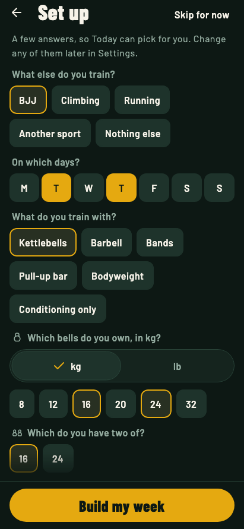

# Getting started

## The welcome

A fresh install opens once on four short pages: what the app is, then an illustrated page each for **Today**,
**Train** and **Log**, each drawn on the pine panel from the tab's own parts. Skip, or the last page, takes you to
Set up. If you had the app before, or there is anything in it already, it opens straight on Today.

## Set up

Set up builds your week from a few questions. It's where the welcome ends, and you can come back to it any time
from Today's empty card or **Settings › Plan**.

1. **What else do you train?** BJJ, climbing, running, a sport of your own, or nothing else.
2. **On which days?** Those days are kept for your sport.
3. **What do you train with?** Kettlebells, a barbell, bands, a pull-up bar, bodyweight, or conditioning only.
   Kettlebells go on to ask which bells you own, in kg or lb, and which of them you have two of; a barbell, which
   bar you use.
4. **How long is a session?** The longest day of the program it picks will fit.

{ width="260" align=right }

It shows the week those answers come to before it builds anything. Then it:

- picks a program your equipment and time are enough for (one bell or a pair, a barbell, bands, a pull-up bar or
  bodyweight alone), then a beginner's; with bells it suits your sport first: a grappler's beside BJJ, shoulders
  (or bands and bells) beside climbing, two days a week at most beside running;
- with conditioning only, follows no program and plans conditioning presets on the free days;
- puts your sport on its days and the program's days on the free ones, spread evenly with a rest day left;
- with BJJ on two days or fewer and a grappler's program, adds **15:15 MVO2** snatch intervals on a third day;
- saves your equipment and sets your weekly goal.

Running it again replaces only what it built last time (the sport's weekly days, the program's, and its 15:15).
Anything else you planned stays, and its days are kept free. A program you already follow is never restarted.

## The first week

Today carries a **First week** card until you hide it. Each step ticks itself off as you do it:

- [x] Build the week
- [ ] Do a first workout or session
- [ ] Follow a flow
- [ ] Log a day of your sport (if you plan or log one)

Nothing about it is stored: it is worked out from your plan and your log. **Hide** turns it off for good.

