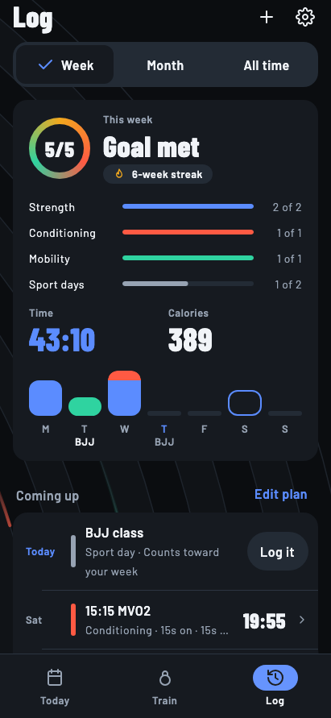
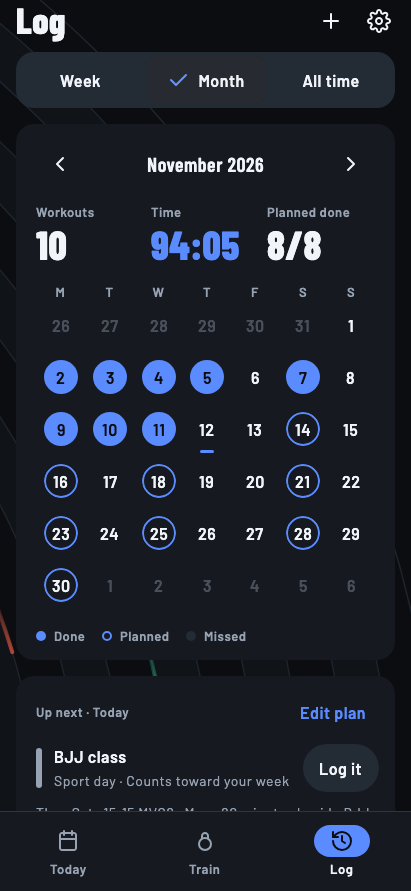

# The Log & the plan

The **Log** tab (History, in the code) is everything done and everything planned.

<figure markdown><figcaption>This week</figcaption></figure>
<figure markdown><figcaption>The month</figcaption></figure>

## What it shows

- **This week**: each kind of training (strength, conditioning, mobility, sport days) done against its plan,
  and what is coming up as a schedule.
- **The month**: a calendar of done, planned and missed days. Tap a day for its sheet.
- **Totals, 12-week heatmap, weekly goals and streaks**, all time.
- **Trends**, from the foot of All time: the last 12 weeks of time trained, weight lifted and heart load, each
  week against your usual one; how far your heart falls a minute into its rests, workout by workout, and which
  way that is going; the records you set, newest first; and each test's results with the same bell.
- **Each workout, session and recorded class**: its page, with its rounds or sets, how hard it was, your note,
  and a dedicated heart-rate card (average, peak, zone-banded chart, time in each zone, 60-second recovery and
  heart load when recorded on a sensor or read from Health Connect / Apple Health).

## Sport days

Plan the classes and days you train away from the app (BJJ, climbing, running, or a sport of your own), weekly
or on dates. **Log it** from Today or the Log, Undo if you didn't mean to. A logged sport day counts as a workout
in the week, the streak and the widget. One you didn't log is never counted as missed.

## Logging after the fact

Trained without the Timer, or forgot? On any day's sheet, today or a day gone by, **Log a workout**:

- a preset or the Timer's workout,
- a flow,
- a sport day,
- or your program's next day, **done as planned**: every set at the load a session would have suggested.

Each comes with Undo. A planned interval workout's or program day's row has **Log it** too. What you log by hand
isn't sent to Health Connect or Apple Health.

## Moving a plan

A missed plan has **Move**, and today's has **Not today** on Today. Pick a day of the week ahead (the first free
one is chosen for you). The day it left reads *Moved to Saturday*, not Missed, and nothing counts it there. A
sport keeps its day.

## Planning

Add to the plan by weekday, on a date, or in words: `tabata mon wed fri`,
`8 × 20/10 then 5 × 1:00/0:30 mon`. Interval workouts, Lift program days and sport days can all be planned.
[Set up](getting-started.md#set-up) builds a whole week at once.

## Reminders

Set a time on Plan and you get one reminder on each day with something still to do, for the next two weeks. On
Android they survive a reboot and keep moving ahead without the app being opened; on iOS they move ahead
whenever the app runs. The app asks for leave to show notifications first.
