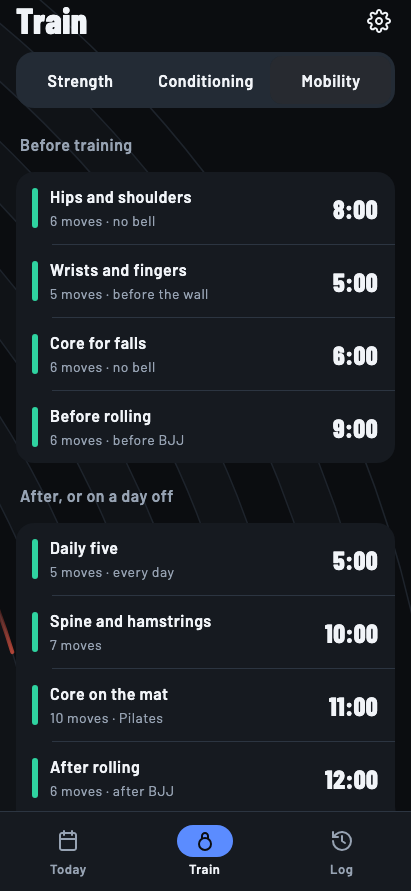
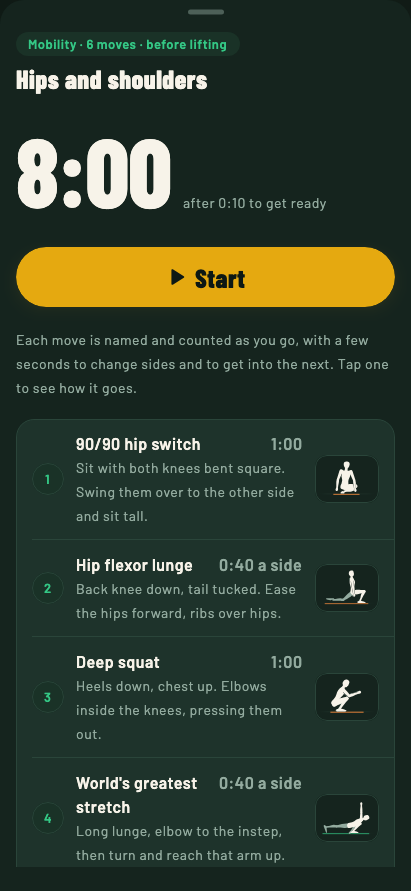

# Mobility

Train's **Mobility** pillar lists the flows by when each is for. Tap one for its sheet: every move with its time
and cue, then **Start**.

<figure markdown><figcaption>The flows</figcaption></figure>
<figure markdown><figcaption>A flow before Start</figcaption></figure>

## The nine flows

| Before training | Minutes | After, or a day off | Minutes |
|---|---|---|---|
| Hips and shoulders | 8 | Daily five | 5 |
| Wrists and fingers | 5 | Spine and hamstrings | 10 |
| Core for falls | 6 | Core on the mat | 11 |
| Before rolling | 9 | After rolling | 12 |
| | | Full reset | |

## Following along

A flow runs on the workout screen: the move's name, *Hold* or *Move*, its cue and the clock, with 10 seconds
between moves and 5 between sides. The voice says what's next (*Next: Cat-cow*, *Left side*, *Switch sides*). A
move that is one of Lift's exercises is shown by its animated figure in a band over the ring; tap it for the
move's page. It leaves the Timer's own settings alone, and is written to Health Connect or Apple Health as
stretching.

## Your own

**New flow** builds one from the library's mat moves and floor holds, or moves you type in, each timed in
five-second steps, done on each side or not. **Make it yours** on any shipped flow starts from a copy. Two flows
can't have exactly the same shape (moves and times), and the editor says so if yours matches one.

## On Today

On a sport's day Today leads with the flow for before it. On a rest day it offers a gentle one, and **Something
else** includes the longest flow that fits the minutes you pick. A week's summary says how many of its workouts
were mobility.
