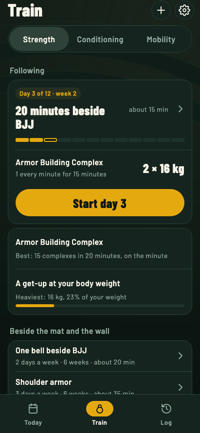
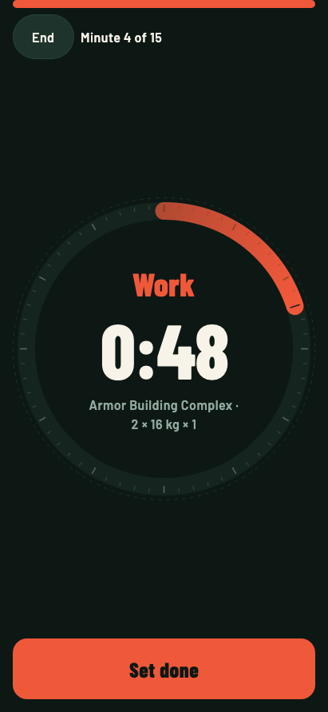
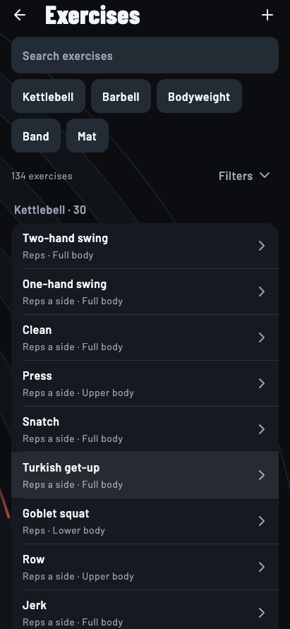
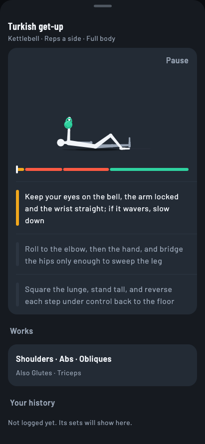

# Strength

Train's **Strength** pillar is Lift: kettlebell, barbell, bodyweight, band and mat training by program or on
your own.

<figure markdown><figcaption>The Strength pillar</figcaption></figure>
<figure markdown><figcaption>The ABC, a pair of bells every minute</figcaption></figure>
<figure markdown><figcaption>The exercise library</figcaption></figure>
<figure markdown><figcaption>A rep shown by a figure, beside its cues</figcaption></figure>

## The pillar

**Following**
:   The program you follow, its next day and how far through it you are, with about how long the day takes.

**Beside the mat and the wall**
:   Programs built to sit beside a sport: *20 minutes beside BJJ*, *One bell beside BJJ* and others.

**On your own**
:   A free session, the library and your gear.

**Lately**
:   Your last session and a four-week balance across seven muscle groups, primary and assisting work apart.

## Programs

27 built-in programs in six families: Beginner, Classic, Dan John (*Armor Building Formula*, *Easy Strength*,
*One-stop shop*), Grappling, Mixed and Barbell. Each day says about how long it takes (*about 20 min*), from its
sets, each lift's pace and your rest between sets.

- **Make it yours** copies a built-in into your own (*(yours)*) to change rep ranges, holds, bands, a pair of
  bells or the schedule, keeping your day and progression.
- **Progression** builds reps within a range, then works denser, then a harder lift at the same bell, and only
  then steps to the next bell or band. Two bells step up only to a weight you own two of.
- A **Very hard** or **All out** on a session holds the next step up back until you approve it.
- A free session can take a day of any program: **Do a program day**, under its Next set card.

## A session

Log each set's load (one bell or two, barbell plates, bodyweight plus a load, a band) and reps; the rest timer
starts on its own. A block can be:

**EMOM**
:   Every minute on the minute, timed and beeped.

**A hold**
:   A timed hold or carry, with its own clock.

**A density block**
:   As many rounds of a lift as fit a time cap. Tap each round as it's done; the clock is called aloud.

Timers keep going with the screen off: on Android a notification counts them down on the lock screen, on iOS a
Live Activity. A session, its timers and the set you were typing survive the app being closed. Records are found
as you go (heaviest, most reps, longest carry), and the next lift's figure raises its bell for one.

## The exercise library

134 lifts across kettlebell (with 18, 22, 26 and 30 kg competition bells, half snatches, push presses, and
farmer's, suitcase, rack and bottoms-up carries), barbell, bodyweight, band and mat Pilates. Every one is shown by
an animated figure doing a rep, its cues lit in turn. Each exercise's page draws your best set each session
(weight × reps) over your latest 24, a dashed rule at each move to another bell, with lifetime totals and best
pace. Add your own exercises too.

## Gear, challenges and tests

- **Gear**: the bells you own (and pairs), a bar and plates, bands, and your records.
- **Challenges** under the program: 10,000 swings, the snatch test, the Armor Building Complex's best twenty
  minutes, a get-up at your body weight.
- **Tests** are attempts done on purpose (the snatch test, the complex, the press, push-ups, pull-ups, the
  plank), each compared with your last at the same bell.

## Coaching

Lift works out its coaching from what you log, and stores nothing extra:

- **The grip**: each set weighed by its reps and how hard the lift is on the hands, BJJ days included. It warns
  when the week runs well past the weeks before, and suggests hand care.
- **Readiness**: after a very hard session, BJJ on a heavy grip week, or an overreached grip, the day is offered
  easier before its first set.
- **Before a big jump in bell**, it tightens the rest first.
- **Safety lines** in place of a set-up cue, such as a thrown lift's first set at a bell new to it.
- **15:15 snatches**: snatches counted on a 15:15 MVO2 workout's summary count as Lift sets too, for the snatch
  test, totals, pace and grip.

How it decides each of these is in [Kettlebell coaching](../kettlebell-coaching.md).
