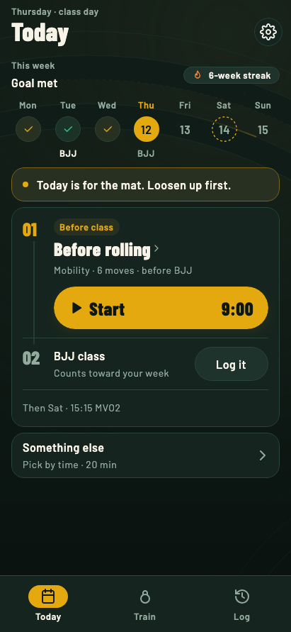

# Today

{ width="260" align=right }

Today is the first tab, and the one the app opens on. It says what kind of day it is and lays the day out as a
coach would.

## From the top

- **The day and its kind** over the title (a strength day, a sport's day, a rest day…), in that kind's colour.
- **A coach's line**, led by an icon, only when there's something worth saying: a taxed day and why, a sport's
  day, done for today, a rest day.
- **The week**: a block a day, filled as you train, and a small ring beside *This week*, a segment a day toward
  your weekly goal.
- **The day in order**, on one card.

## The day in order

The card opens on a picture of the day's kind: a strength day, conditioning, mobility, BJJ, climbing, running,
another sport, rest, done, or nothing planned. With large text it's left out, so Start stays in view.

Each step is a row. What is done is ticked. The first step still to do is numbered **01** and sits over the
tab's one raised **Start**, which says how long it runs (or **Log it**, for a sport). The steps after it have
quiet buttons.

On a class day the card might read:

1. *Before rolling*, the mobility flow for before BJJ: **Start · 9 min**
2. BJJ: **Log it**
3. *If there is time*: day 3 of your program

The flow before a sport is picked for it: *Wrists and fingers* before climbing, *Before rolling* before BJJ,
*Hips and shoulders* before running and the rest.

Every pick opens a look at what it is before Start, with **Plan for later** beside it.

## When the day is different

**Done for today**
:   Nothing left: the card says so.

**A rest day**
:   Nothing planned and nothing done. It offers a gentle flow, never a raised Start for another day.

**An easier day**
:   After a very hard session, BJJ on a heavy week for the grip, or a grip that has overreached, Today says why
    and offers the program's day eased: *Start day 3, easier*. Switch it off in Settings if you'd rather not.

**Not today**
:   Moves today's plan to a free day of the week ahead. The day it left reads *Moved to Saturday*, never Missed.

**Something else**
:   Folds open the picks by time on a day that already has its answer: the program's next day when it fits,
    then presets and flows that fit 5, 10, 15, 20 or 30 minutes. It opens on your session length from Set up.

