

  

    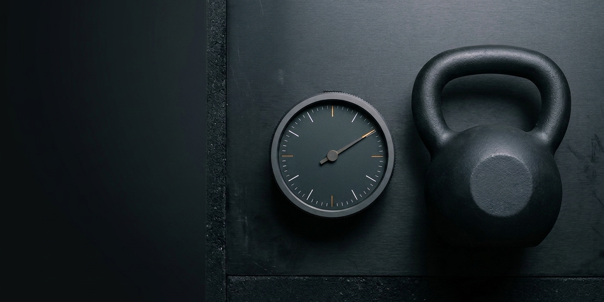
    

      <h1 class="hero__title">Interval</h1>
      
Conditioning · Strength · Mobility

    

  

**A training companion for interval conditioning, kettlebell strength, guided mobility and the week's plan,
on Android, iOS and desktop.** Everything stays on your device: no account, no analytics, no ads.

[Get started](guide/getting-started.md){ .md-button .md-button--primary }
[Read the guide](guide/index.md){ .md-button }
[Source on GitHub](https://github.com/smithjustinn84-netizen/interval){ .md-button }

## Three tabs

-   :material-calendar-today:{ .lg .middle } **Today**

    ---

    The week against your goal, a coach's line on what kind of day it is, then the day in order on one card,
    with one Start.

    [:octicons-arrow-right-24: Today](guide/today.md)

-   :material-dumbbell:{ .lg .middle } **Train**

    ---

    Three pillars: **Strength** (27 programs, 134 lifts, every one shown by a figure), **Conditioning** (the
    Timer and presets) and **Mobility** (nine follow-along flows and your own).

    [:octicons-arrow-right-24: Strength](guide/strength.md) ·
    [Conditioning](guide/conditioning.md) ·
    [Mobility](guide/mobility.md)

-   :material-notebook-outline:{ .lg .middle } **Log**

    ---

    Each kind of training this week against its plan, a month calendar, sport days, workouts logged after the
    fact, and a plan you can move.

    [:octicons-arrow-right-24: The Log & the plan](guide/log-and-plan.md)

-   :material-shield-lock-outline:{ .lg .middle } **Yours, offline**

    ---

    Local storage, a full export to one file, Health Connect and Apple Health only if you connect them.

    [:octicons-arrow-right-24: Privacy](privacy.md) · [Your data](guide/your-data.md)

## A look around

<figure markdown>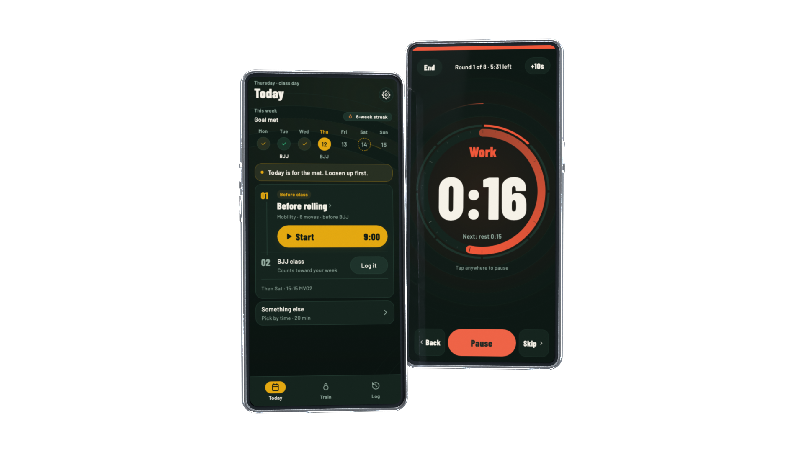<figcaption>Today & the live chronograph ring</figcaption></figure>
<figure markdown>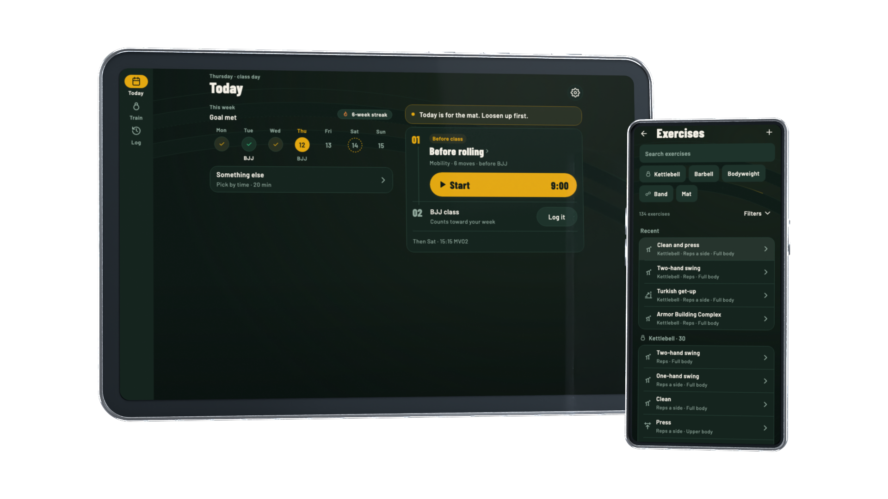<figcaption>Tablet & phone, offline together</figcaption></figure>

<figure markdown>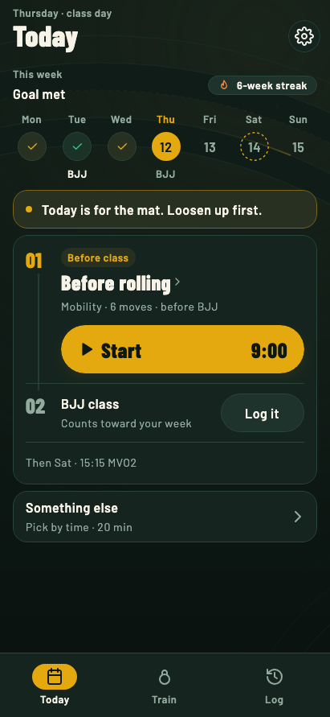<figcaption>Today</figcaption></figure>
<figure markdown>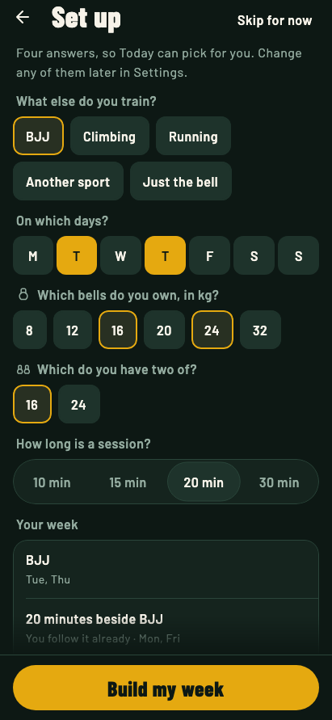<figcaption>Set up</figcaption></figure>
<figure markdown>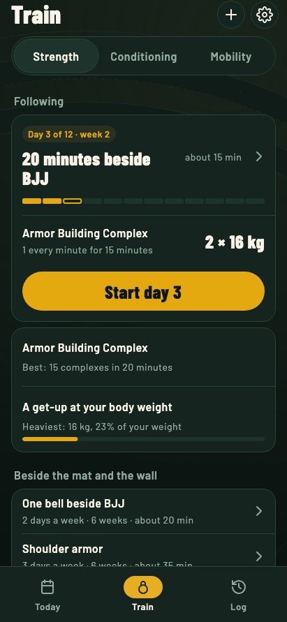<figcaption>Train · Strength</figcaption></figure>
<figure markdown>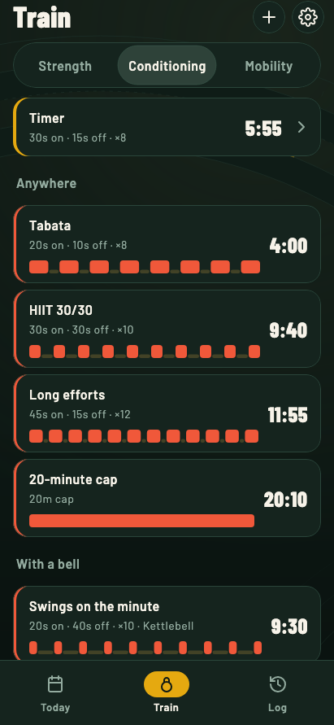<figcaption>Train · Conditioning</figcaption></figure>
<figure markdown>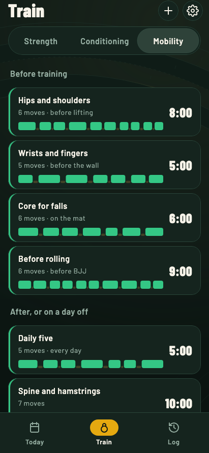<figcaption>Train · Mobility</figcaption></figure>
<figure markdown>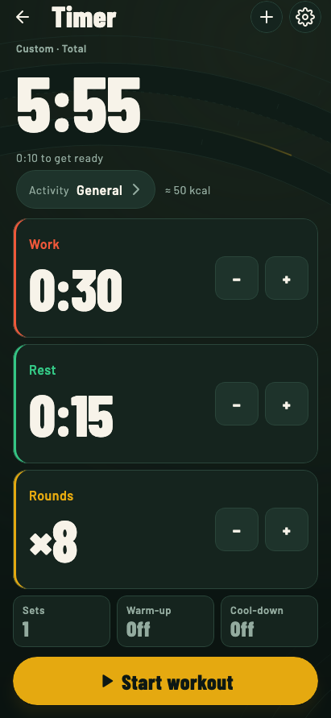<figcaption>The Timer</figcaption></figure>
<figure markdown>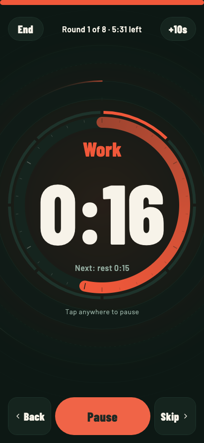<figcaption>A workout running</figcaption></figure>
<figure markdown>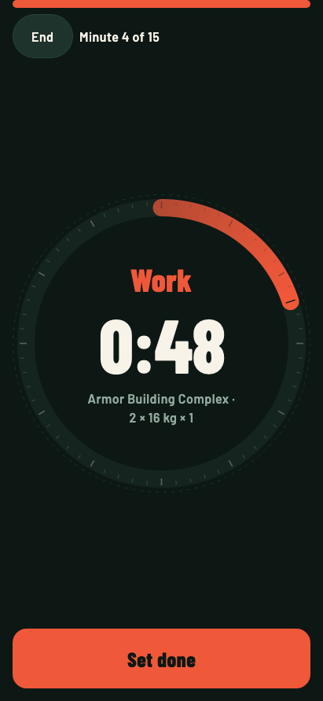<figcaption>An EMOM in Lift</figcaption></figure>
<figure markdown>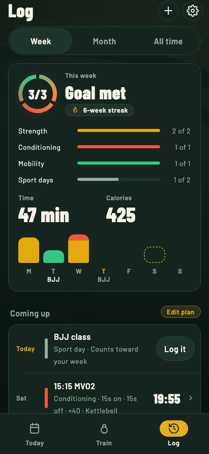<figcaption>The Log</figcaption></figure>
<figure markdown>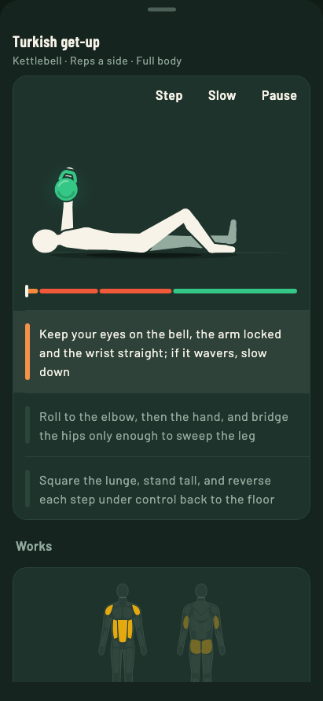<figcaption>Exercises & body map</figcaption></figure>

## Where it runs

| Platform | What you get |
|---|---|
| **Android** | The whole app, Health Connect, Live Updates on Android 16, a home-screen widget, shortcuts, a Polar heart-rate sensor (Android 12+) |
| **iOS** | The whole app, Apple Health, Live Activities on the Lock Screen and in the Dynamic Island, Home Screen and Lock Screen widgets, quick actions |
| **Desktop** | The whole app in a window, for planning and the log; nothing runs with the window closed |

Building it yourself? See [Developers](developers/index.md).
