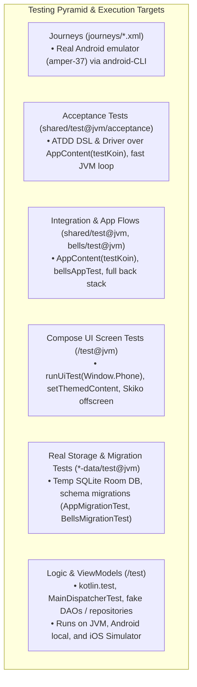

# Testing

How interval is tested, what runs where, and what the Kotlin Toolchain (0.13) can't do yet. The
strategy follows Android's `testing-setup` skill (`android skills add testing-setup`), adapted to a
Compose Multiplatform project with no Gradle.



## What runs where

A test lives in the module of what it tests, so `./kotlin test -m <module> -p jvm` runs just that module's.

| Layer | Where | Runs on | Framework |
|---|---|---|---|
| Logic and ViewModels | `<module>/test/` (`interval-domain`, `bells-domain`, a feature's) | JVM, Android (local JVM), iOS simulator | `kotlin.test`, `kotlinx-coroutines-test` |
| Compose behavior (one screen) | `<feature>/test@jvm/<feature>/XScreenTest.kt` | Desktop JVM | `runDesktopComposeUiTest` |
| Lift's flows (its pages end to end) | `bells/test@jvm/` (`bellsAppTest`) | Desktop JVM | Lift's real entries over fake DI |
| Navigation (whole app) | `shared/test@jvm/AppNavigationTest.kt`, `LiftFlowTest.kt` | Desktop JVM | `AppContent` over fake DI |
| Acceptance Tests (ATDD) | `shared/test@jvm/acceptance/*AcceptanceTest.kt` | Desktop JVM | `IntervalAcceptanceDriver`, `AppContent` |
| End to end, on a device | `journeys/*.xml` | Android emulator, run by an agent | `android` CLI journeys |

**Compose UI tests go in `test@jvm/`, never `test/`.** Common `test/` also runs as Android local
tests, which have no Robolectric here, so `runComposeUiTest` would fail there. The desktop JVM runs
the same common UI code.

## Commands

```sh
./kotlin test -p jvm                         # Logic + Compose UI + navigation, the fast loop
./kotlin test -m interval-history -p jvm     # One feature's logic and screen tests
./kotlin test -m bells-domain -p jvm         # A pure domain's, in seconds
./kotlin test -m bells -p jvm                # Lift's flows
./kotlin test -m shared -p jvm               # The app's navigation and container
./kotlin test -p android                     # Common tests as Android local tests
./kotlin test -p iosSimulatorArm64           # Common tests in the iOS simulator (macOS)
./kotlin check                               # Tests + ktlint + detekt
./kotlin build                               # Full build incl. the iOS link; catches opt-in leaks
```

CI (`.github/workflows/ci.yml`) runs the JVM and Android tests on Linux and the iOS tests on macOS, with
lint and detekt in a job of their own. It runs on pushes to `main`, `v*` tags and pull requests, skipping
changes that touch only Markdown, `docs/` or `journeys/`. Run it on any bookmark with
`gh workflow run CI --ref <bookmark>`. The iOS tests run in four shards beside the app's
build, two modules at a time in each: one `test -p iosSimulatorArm64` links every module's test binary at once
(about 16 GB), more than the runner's 7 GB, and one after another they take longer than a job's timeout.
Each shard is a line of `tools/ios-test-shards.txt`, grouped by the part of the tree its modules compile: a new
module with tests goes on one of its lines, or `tools/check_ios_shards.py` fails the run. `main` requires the `CI`
job (the ruleset "main: CI must pass"), which passes only when every other job did; admins bypass it, so a
direct push still lands. A failure attaches the detekt reports, the
Linux JUnit XML or the iOS shard's toolchain logs to the run.
The UI tests render offscreen with Skiko and need no display, including on the Linux runner.

## Test infrastructure

The toolchain shares no test sources between modules, so what tests share lives in ordinary library
modules that a module lists under `test-dependencies` (the `tested-lib` template adds `core-testing`;
a module adds its side's). A data module's tests may depend on its side's `*-testing` module even though
that depends on the data module.

- **`core-testing`** (common, every platform):
  - `MainDispatcherTest`: the base class for a ViewModel's test, which stands in a test dispatcher
    for `Dispatchers.Main` (unconfined unless the test passes another).
  - `FixedTimestampFormatter`: time-zone free; `date()` is `"day N"`, `monthTitle()` `"M/YYYY"`.
  - `FakeAppInfo`, and the tests' calendar: `TODAY` (Thursday 15 October 2026), `noonOf`, `DAY_MILLIS`.
- **`core-testing/src@jvm/ui/UiTestHarness.kt`**:
  - `runUiTest(Window.Phone | PhoneSideways | Tablet | TabletPortrait | Desktop)`: sized windows that match the previews. The
    window size drives the same layout decisions as on a device (bar vs rail, Settings as a
    supporting pane).
  - `setThemedContent { }`: content inside `IntervalTheme`, light (`dark = true` for dark).
  - `waitForText`, `scrollToText`: for whole-app tests, whose ViewModels emit on Swing's thread.
  - `StateRestoration`: saves and restores `rememberSaveable` state. Use it instead of
    `StateRestorationTester`, which throws `NotImplementedError` on desktop.
  - It exports `$compose.uiTest` and carries Skiko's natives (`$compose.desktop.currentOs`, see KTC-5525)
    and `kotlinx-coroutines-swing` (`Dispatchers.Main` for `viewModelScope` when real routes are composed).
- **`interval-testing`** (`dev.justinsmith.interval.fakes`):
  - `FakeStorage`: an `InMemoryDataStore` plus `FakeHistoryDao`, `FakePresetDao` and `FakePlannedDao`. Its
    `repository()` runs writes unconfined over fakes that never suspend, so a write has landed by the
    time the call returns. Two repositories over one `FakeStorage` are the app before and after a
    restart. That hides code that reads repository state back right after writing it, which in the
    app lands later, on `Dispatchers.IO`: test such code with `repository(scope = deferredStorageScope())`,
    whose writes wait for the test's scheduler (`runCurrent()`/`advanceUntilIdle()`). Not
    `backgroundScope`: `advanceUntilIdle` leaves background work waiting.
  - `RecordingCuePlayer`: records beeps, `Speech` lines and haptics. `RecordingBackgroundWorkout`: what the
    platform was told to keep. `RecordingPlanReminders`: every set of reminders the platform was handed,
    `pending` the latest.
  - `fakePlatformModule(...)` binds the player and formatter for Koin; `fakeStorageModule(...)` binds a
    `FakeStorage` in place of the real `storageModule`.
  - `tabataPreset`, `hiitPreset`, `hangboardPreset`: the built-ins tests lean on, found by name.
- **`bells-testing`** (`dev.justinsmith.bells.fakes`): `FakeBellsStorage` over the six fake DAOs, with
  `repository()` and `finished(...)`; `FakeIntervalActivity`; `RecordingBeeper`; `fakeBellsPlatformModule`,
  `fakeBellsStorageModule`; `bellsTestKoin(...)`, Lift's part of the container over them.
- **`testKoin(...)`** (`shared/test/fakes/TestKoin.kt`): the app's real container over the fakes of both
  sides, with the `WallClock` fixed at `now`.

  Never load the real platform or storage module in a test: on the JVM they write to the user's
  app-data directory and play sound.
- **Real storage** is tested in `interval-data/test@jvm/data/StorageTest.kt`: the repository over a DataStore
  and a Room database in a temp directory, with writes on `Dispatchers.IO`, including a restart, and
  `AppMigrationTest` opens databases left at an earlier version; Lift's are in `bells-data/test@jvm/data/`
  (`BellsRoomTest`, and `BellsMigrationTest` over its `schemas/`).
  `AppKoinStorageTest` (`shared/test@jvm/data/`) wires the real `storageModule` and rebuilds the container
  straight after closing it, as Android does when the Activity reopens in the same process. All are
  JVM-only because Room's Android in-memory builder needs a `Context`, and common tests also run as
  Android local tests without Robolectric.
- **`AppContent(koin)`** (`shared/src/App.kt`) is `App()` with its container passed in. Navigation
  tests compose it with `testKoin()`: real ViewModels, repository and navigation over fake platform
  services. `App()` stays parameterless for the entry points.
- **`bellsAppTest(...)`** (`bells/test@jvm/ui/BellsUiTestHarness.kt`) hosts Lift's pages on a back stack of
  their own through the same `liftEntries` the app composes, over `bellsTestKoin`; its fixture holds the
  storage, the clock, the beeps and `back()`, the system back gesture.

## Writing UI tests

- Drive the stateless `XScreen(state, callbacks)` with a fixed state and callbacks that record
  calls, in the feature's `test@jvm/`. Use `bellsAppTest` or `AppContent` only for flows and navigation.
- Match on semantics first: text, `contentDescription`, `hasClickAction()`, `isDialog()`. Add a
  `testTag` only when an element would otherwise take more than three matchers. App code needs none so
  far; a test may still tag the boxes it draws itself.
- Assert the English text literally ("Next: rest 0:15"), not through `getString`: an expectation read
  from the same key can't catch a screen showing the wrong one. This is where the words are tested;
  common ViewModel tests assert typed state and never load a resource (Android local tests can't).
- Section titles are headings for screen readers: `GroupLabel`, the title bar, a dialog's title, and the
  titles a sheet, a summary or a page draws itself (`Modifier.semantics { heading() }`). Assert one with
  `isHeading()` (`interval-ui/test@jvm/ui/HeadingsTest.kt`), so a title that loses its semantics fails a test.
- Use `androidx.compose.ui.test.v2.*`, because the v1 `runComposeUiTest` is deprecated and
  `allWarningsAsErrors` rejects it. Opt in per file with `@file:OptIn(ExperimentalTestApi::class)`,
  never module-wide.

### Screen Test Pattern Example

```kotlin
@file:OptIn(ExperimentalTestApi::class)

package dev.justinsmith.interval.settings

import androidx.compose.ui.test.ExperimentalTestApi
import androidx.compose.ui.test.assertIsDisplayed
import androidx.compose.ui.test.onNodeWithText
import androidx.compose.ui.test.performClick
import dev.justinsmith.interval.ui.Window
import dev.justinsmith.interval.ui.runUiTest
import dev.justinsmith.interval.ui.setThemedContent
import kotlin.test.Test
import kotlin.test.assertEquals

class SettingsScreenTest {
    @Test
    fun togglingCueInvokesCallback() = runUiTest(Window.Phone) {
        var toggled = false
        setThemedContent {
            SettingsScreen(
                state = SettingsUiState(/* test fixtures */),
                onToggleCues = { toggled = true },
            )
        }

        onNodeWithText("Sound cues").performClick()
        assertEquals(true, toggled)
    }
}
```

### Visual Debugging (Desktop Screen Capture)

Because UI tests execute off-screen via Skiko on the JVM, you can capture the visual output to inspect a layout
or diagnose an unexpected state:

```kotlin
import androidx.compose.ui.graphics.asSkiaBitmap
import androidx.compose.ui.test.captureToImage
import androidx.compose.ui.test.onRoot
import org.jetbrains.skia.Image
import java.io.File

// Inside runUiTest:
val image = onRoot().captureToImage()
val bytes = Image.makeFromBitmap(image.asSkiaBitmap()).encodeToData()?.bytes
File("/tmp/screen-test-output.png").writeBytes(bytes!!)
```
*(Remove throwaway capture code before committing)*.

### Database & Migration Tests

When Room entities change or migrations are added:
- Run `interval-data` tests: `./kotlin test -m interval-data -p jvm`
- Run `bells-data` tests: `./kotlin test -m bells-data -p jvm`
- Room schema exports are stored in `interval-data/schemas/` and `bells-data/schemas/`.
- `AppMigrationTest` and `BellsMigrationTest` build databases against legacy schema versions, apply migrations, and
  verify that data rows and types are preserved without data loss.

## Acceptance Test-Driven Development (ATDD)

For user-facing journeys and feature development (especially when collaborating with AI agents),
the codebase applies **Acceptance Test-Driven Development (ATDD)** as articulated by Dave Farley
(*The Industry Is Catching Up: The Only Way to Generate AI Code That Works*).

### Why ATDD for AI-Assisted Development
1. **Verification is the Bottleneck**: Generating code with AI is instantaneous, but verifying
   unstructured code manually is unsustainable. Automated acceptance tests provide an unambiguous,
   machine-executable specification ("Definition of Done").
2. **Prompts Drift, Tests Do Not**: Natural language prompts are ambiguous wishes. An executable
   acceptance test serves as a deterministic contract that constrains the AI agent.
3. **Double-Loop TDD**:
   - **Outer Loop (Acceptance Test)**: Written first in ubiquitous domain language, testing the
     system from the boundary (`shared/test@jvm/acceptance/`). Initially fails (**RED**).
   - **Inner Loop (Unit TDD)**: Drives domain models, state machines, and calculations in pure Kotlin
     multiplatform (`<module>/test/`) with micro-tests.
   - **Green**: Once internal logic and UI wiring satisfy the outer specification, the acceptance
     test passes (**GREEN**).
   - **Refactor**: Clean up and optimize while both loops verify safety.

### The Acceptance Driver Pattern

Acceptance tests must not be fragile scripts bound to exact widget selectors, coordinates, or timing.
`IntervalAcceptanceDriver` (`shared/test@jvm/acceptance/IntervalAcceptanceDriver.kt`) encapsulates the
Compose semantics tree behind ubiquitous domain operations:

```kotlin
class StartWorkoutAcceptanceTest {
    @Test
    fun `user can configure work time, start, pause, resume, skip, and discard workout before completion`() =
        acceptanceScenario {
            verifyTimerScreenShown()

            tapIntervalRow("Work")
            verifyValueSheetShown("Work")
            selectQuickPick("1:00")
            tapDone()
            verifyIntervalValue("Work", "1:00")

            startWorkout()
            verifyWorkoutPhase("Get ready")

            pauseWorkout()
            verifyWorkoutPaused()
            resumeWorkout()
            verifyWorkoutRunning()

            skipPhase()
            verifyWorkoutPhase("Work")
            verifyWorkoutStatus("Round 1 of 8")

            endWorkout()
            verifyEndWorkoutDialog("nothing is saved")
            confirmEndWorkout()

            verifyTimerScreenShown()
        }
}
```

### Fast JVM Execution vs Device Journeys
While `journeys/*.xml` remain valuable for full-system Android emulator validation, acceptance tests
under `shared/test@jvm/acceptance/` run offscreen in seconds via Skiko on the JVM. This enables running
them continuously in CI (`./kotlin test -m shared -p jvm`) and using them as the primary inner/outer
feedback loop for AI development.

## Journeys (on-device end to end)

`journeys/*.xml` describe user flows in plain steps, in the format of the `android-cli` skill's
`references/journeys.md`. An agent runs them against the emulator with `android layout`,
`android screen capture` and `adb shell input`, then reports a JSON pass/fail per step. They are
not run in CI.

```sh
./kotlin build -m androidApp
android emulator start amper-37
android run --apks=build/tasks/_androidApp_buildAndroidDebug/gradle-project-debug.apk
adb shell pm clear dev.justinsmith.interval      # Most journeys expect a fresh install
```

| Journey | Covers |
|---|---|
| `start-workout.xml` | Edit work time via the sheet, start, pause/resume, skip, end with nothing saved |
| `history.xml` | Set a weekly goal from the first run, end after a round, find it in History and open it, see it on the month, clear History |
| `presets.xml` | On the Presets page (All presets on the Timer): save the Timer's settings, put a built-in on the Timer and start one from its sheet, edit and delete the saved one, open New preset |
| `settings.xml` | Toggle a cue, switch to Dark and back, settings persist |
| `system-back.xml` | System back from a tab returns to Timer; during a workout it pauses and asks |
| `lift-equipment.xml` | A Lift session logging a bell, a band, a hold on one side and bodyweight with weight added, each in its own words, Moved counting only the weighed load, then the summary |
| `lift-barbell.xml` | A barbell lift: the bar chosen, plates a side, and the set logged with its load |
| `lift-plan-changes.xml` | A program's day with a change to its plan: kept for the session, for the program, or in a copy |
| `lift-rest-alert.xml` | A rest between sets keeps counting on the lock screen and beeps as it ends with the screen off |
| `reminders.xml` | Turn the plan's reminder on, pick a time, see it in the notification settings, turn it off |
| `exercise-library.xml` | The library from Lift: search, equipment chips, Filters and Clear; Add from a search that finds nothing, edit, a name already taken; pick your own on the Log sheet; equipment locked once logged |

On the `amper-37` image, the first tap into a text field may open Gboard's "Try out your stylus"
tutorial. Cancel it and type again. It's the emulator's keyboard, not the app.

## Not available under the Kotlin Toolchain (0.13)

| Skill step | Status |
|---|---|
| Instrumented tests (`androidTest`) | Not supported. Journeys cover on-device behavior instead. |
| Robolectric | No support: no merged manifest or resources for local tests (KTC-4241). |
| Screenshot tests (Compose Preview Screenshot Testing, Paparazzi, Roborazzi, Dropshots) | Need AGP or Gradle plugins. Desktop options exist but were skipped for now. Goldens rendered on macOS won't match Linux CI. |
| Coverage (JaCoCo, Kover) | No support yet (KTC-416). A JVM agent through `settings@jvm: jvm: test: freeJvmArgs` would work, but was skipped. |
| Test fixtures | No sharing of `test/` between modules: shared fakes are the `*-testing` library modules. |
| Database tests | Room and DataStore over temp files in a data module's `test@jvm/data/` (JVM only: Android's Room builder needs a `Context`). |
| Hilt, Mockk | N/A: DI is Koin, and hand-written fakes cover every injected interface. |
